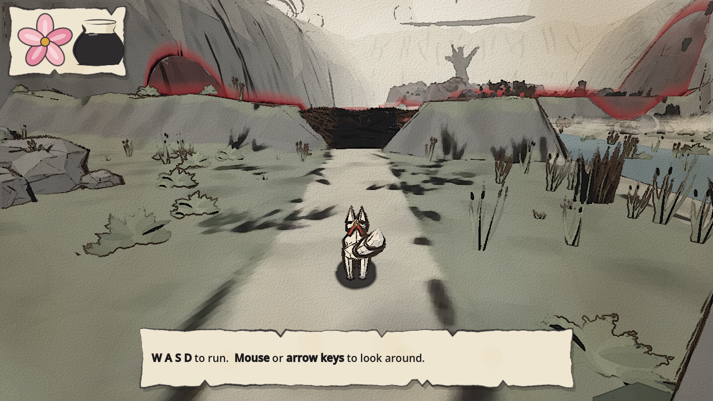
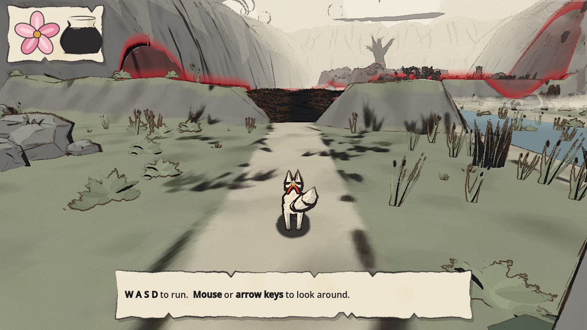
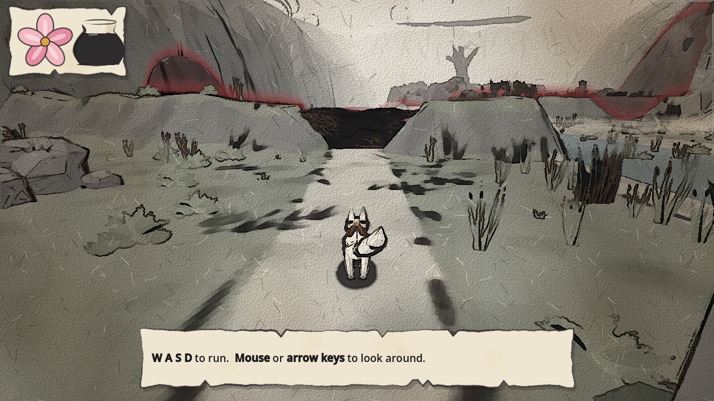

# Orimi: The Unfaded Vale

An original living-ink action-adventure made with Godot 4.7.2. You play Orimi, a fox folded from
shrine paper, who carries a brush that still remembers how colour goes. Ink has spilled down the
river Lull and drained the land grey. Walk the valleys, fight what the ink left behind, and paint
the colour back.

Everything in the project is original and made by scripts in this repository: models, textures,
music, sounds and shaders. The game runs on desktop (Forward+) and in a desktop browser
(Compatibility renderer, WebGL 2). The browser build is the one every feature is tested against.

## Status

Book One, "Upriver", is five levels played in order (docs/LEVELS.md). The automated player finishes all five in one browser run.

| # | Level | State |
| - | - | - |
| 1 | Hazewater Vale | Playable from title to end card |
| 2 | Tallowford | Playable; follows Hazewater Vale by Pell's raft, or loads with `level=tallowford` |
| 3 | Sedge Plain | Playable; follows Tallowford, or loads with `level=sedge_plain` |
| 4 | Mosswater Wood | Playable; follows Sedge Plain, or loads with `level=mosswater` |
| 5 | The Hollow Kiln | Playable; ends Book One, or loads with `level=hollow_kiln` |

A small test level that uses every part of the level kit loads with `level=example`.

## Controls

| Action | Keyboard and mouse |
| - | - |
| Move | W A S D |
| Look around | Mouse (click the game once to capture it), or the arrow keys |
| Jump | Space (hold for a higher jump) |
| Attack | Left mouse button, or J |
| Brush | Hold Shift, Q or the right mouse button, then draw with the left mouse button; let go to cast |
| Talk | E or Enter, when close to someone |
| Pause | Esc or P |
| Paper intensity | F2 or O cycles Light, Normal, Heavy |

A pen tablet works for the brush in the browser and on desktop.

### The brush

Hold the brush button and time stops while you draw on the paper. Each shape costs ink, which
comes back over time and from defeated enemies.

| Glyph | Draw | Does |
| - | - | - |
| Bloom | A closed loop around something | Restores a withered sapling, wakes a verse-stone |
| Slash | A straight line through something | Cuts thorns and ink cord, finishes an unravelling enemy |
| Gust | A curl: one line that crosses itself once | Blows soot away, unveils a Reedwraith |
| Kindle | A quick dab on a wick | Lights lamps, braziers and lantern-fruit |
| Tie | A straight line from one tie post to another | Ties a rope: a bridge, or a pull |

The pause menu shows the glyphs as you learn them.

## Run it

The scripts below are for Git Bash on Windows and are run from the top of the checkout. They use
a private copy of Godot, Blender and Python under `.tools/`, which is not in the repository;
`tools/setup_tools.sh` downloads and prepares it (docs/TOOLCHAIN.md lists versions and sources).

| Do this | Command |
| - | - |
| Prepare `.tools/` once | `tools/setup_tools.sh` |
| Check that every script loads and the game boots | `tools/check.sh` |
| Play on desktop | `tools/run_desktop.sh` |
| Build the browser version | `tools/export_web.sh` (writes `build/web/index.html`) |
| Play in the browser | `tools/serve_web.sh`, then open the address it prints in Chrome or Edge |
| Open the project in the Godot editor | `tools/editor.sh` |

Without the scripts: open `project.godot` in Godot 4.7.2 and press Play. For the browser, export
with the "Web" preset and serve the output folder from a local web server; opening the HTML file
straight from disk does not work.

### Boot options

The same options work on desktop after the script name and in the browser as a query string
(`index.html?level=example&paper=heavy`).

| Option | Meaning |
| - | - |
| `level=<id>` | Start in a level: `hazewater`, `example`, or a level still in progress |
| `paper=light\|normal\|heavy` | Paper intensity at start |
| `warp=<marker>` | Start at a marker of the level, for example `warp=M_ZoneA` in Hazewater Vale |
| `god=1` | Orimi takes no damage |
| `fresh=1` | Ignore saved progress |
| `post=0` | Turn the paper and ink post chain off |
| `autoplay=1` | The game plays itself along the level's scripted route (used by the tests) |
| `scene=res://...` | Load another scene instead of the game, for example a look-dev scene |

## The look

The picture is built from a toon-shaded scene with ink outlines, then a post chain that adds
depth-edge ink, paper grain, fibres, staining and a slight watercolour bleed. Places the ink has
taken are drained grey behind a torn black edge with a red glow.

Paper intensity changes how much of the paper shows. These are the same view in the browser build:

| Light | Normal | Heavy |
| - | - | - |
|  |  |  |

The desktop versions are `docs/screenshots/valley_{light,normal,heavy}_desktop.png`.

### Shader parameters

Every shader uniform is documented with its type, range and effect:

- docs/SHADERS.md: toon shading, outlines, the post chain and its three paper presets, the
  look of spilled ink, the blob shadow.
- docs/SHADERS_VFX.md: sky, water, foliage, mist, soot and the effect shaders.
- docs/BRUSH.md: the brush canvas and stroke shaders.

## Where things are

| Path | What |
| - | - |
| `docs/BRIEF.md` | What the project set out to build, and its definition of done |
| `docs/LEVELS.md` | The five levels and the story |
| `docs/LEVEL_KIT.md` | How a level is assembled from shared parts |
| `docs/STYLE_GUIDE.md` | The visual rules |
| `docs/CONTRACTS.md` | Names, shared interfaces and who owns which folder |
| `docs/ASSETS.md`, `docs/GAMEPLAY.md`, `docs/TOOLCHAIN.md` | How models, audio, the game code and the tools work |
| `docs/qa/STATUS.md` | The test gate's last result against the definition of done |
| `scenes/levels/<id>/` | One folder per level, with its `level.json` |
| `shaders/`, `scripts/`, `scenes/` | The game |
| `tools/` | Build, test and generator scripts |

## Tests

| Command | What it proves |
| - | - |
| `tools/check.sh` | Every script loads and the game boots headless |
| `tools/game/autoplay_headless.sh [level=<id>]` | The level's scripted route completes, without rendering |
| `tools/game/web_autoplay.sh [level=<id>]` | Exports, then plays the route in Chrome and saves a shot per stage |
| `tools/qa/dod.sh` | The full gate against the definition of done |

## Credits and licences

Everything in this repository was made for this project. No art, sound, music, text or code is taken from another game.

- **Models, textures, music and sounds** are generated by the scripts under `tools/` (Blender scripts for models, Python for textures and audio). Each media folder has a `provenance.json` that names the generator and command for every file with its checksum; `tools/qa/qa.sh provenance` checks them.
- **Engine:** Godot 4.7.2, MIT licence. A web export carries Godot's own third-party notices (see the engine's `COPYRIGHT.txt`).
- **Font:** the interface uses Godot's built-in default font; no font file is shipped in this repository.
- **Build tools, not shipped with the game:** Blender (GPL; the files it writes are ours), Python, Node.js and Chrome for the automated browser runs, and ffmpeg for the trailer. `tools/setup_tools.sh` fetches them into `.tools/`, which is not tracked.
- **Licence for this repository:** none has been chosen yet. Until one is added, all rights are reserved by the owner.
