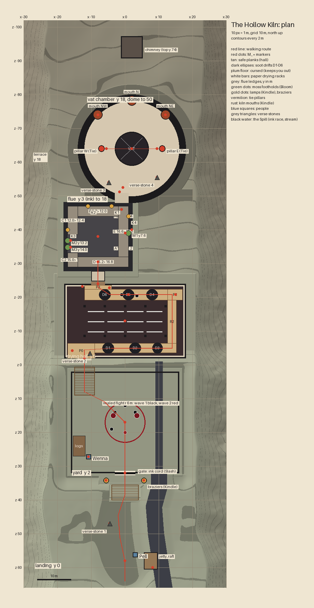
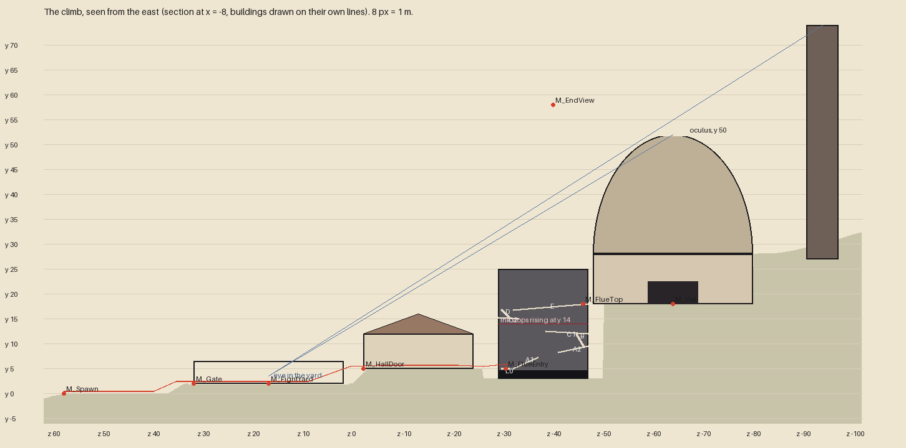

# The Hollow Kiln: level design ("What the Vat Kept")

Level 5 of Book One, the last. Level id `hollow_kiln`. Owner: the l5 workstream. This expands the
Level 5 section of docs/LEVELS.md into something a builder can place from. Every number here comes
from `tools/levels/hollow_kiln/kiln_layout.py`, the module the Blender generators, the ground
painter, the plan drawing and the data exporter all read. Phase B loads the same numbers from
`scripts/levels/hollow_kiln/kiln_layout.json` and the kit data from `scenes/levels/hollow_kiln/level.json`
(both written by `tools/levels/hollow_kiln/export_layout.py`). Metres, Godot axes: X east, Y up, Z south.
The player arrives from the south (+Z) and climbs north (-Z). The talk is in SCRIPT.md.

The plan is drawn to scale from the layout by `tools/levels/hollow_kiln/plan.py` (10 px = 1 m, grid
10 m, contours every 2 m from the same height field the ground models are built from). Legend on the
image. The section below is the same climb seen from the east (8 px = 1 m), with the sight lines
from the yard to the dome and the chimney.

## The place in one paragraph

The Ink-maker's works sit in a narrow gorge at the river's head, where the stream comes out from
under the mountain. They climb the slope the way a climbing kiln does: a stone landing at the
water (y 0), a walled yard (y 2), a long timber drying hall (y 5), a square brick flue shaft that
climbs from the hall's back door to the vat chamber (y 5 to 18), and the vat chamber itself (y 18),
a round brick drum 28 m across under a tall beehive dome with an oculus at y 50 and a square
chimney behind it to y 74. The dome and chimney are seen from the landing over the yard wall and
stay in view (their paper fade is pushed back) the whole way up. While the Spill holds it, the
stream and the open race through the yard run black, the hall's paper is grey, and the whole
works sits in four cursed zones. Restored, the water runs clear, the paper is white and red, and
a tree stands up through the dome.

## Size and shape

| Space | Footprint (x by z) | Floor y | Height | Notes |
| - | - | - | - | - |
| Landing | about 22 m across round M_Spawn | 0 | open | Jetty and raft on the stream's west bank; a stone stair up to the gate apron. |
| Yard | 32 by 30 m (x -16..16, z 2..32) | 2 | walls 4.5 m | Gate in the south wall (6 m wide); open ink race 2.2 m wide down the east side; stair up the west side to the hall door. |
| Drying hall | 36 by 22 m (x -18..18, z -24..-2) | 5 (planks 5.3) | eave 7, ridge 11 | Two rows of five posts, three rows of racks, a cursed floor, the plank route round the edge. |
| Flue | 18 by 18 m (x -17..1, z -47..-29) | 3 (ink) | roof 25 | Ledges spiral up three walls from y 5.6 to 18; the ink pool starts at 4.6. |
| Vat chamber | drum r 14 m, centre (2, -64) | 18 | wall 10, dome to 50 | Vat r 5 m (rim y 22.5) in the middle, two pillars E and W, three kiln mouths on the north arc. |

The four spaces are each about 30 m across, as LEVELS.md asks, except the flue, which trades 12 m
of width for 20 m of height. The gorge walls rise 20 to 26 m beyond x = +-22 and keep the player
in; the valley falls away south of the landing (the "far" model, seen at the end).

## Route, beat by beat

Walking speed 6.4 m/s. A first play is about 10 to 12 minutes; a player who knows the way does it
in about 6.

| Beat | Where | What the player does | Glyphs | First-play time |
| - | - | - | - | - |
| 0 | M_Spawn, the landing | Steps off Pell's raft. Pell: three lines. The dome and chimney stand over the yard wall ahead. | | 0:00 to 0:40 |
| 1 | M_Verse_1 | Verse-stone 1, 11 m up the path on the left. | Bloom | 0:40 to 1:10 |
| 2 | M_Gate | The gate is tied with ink cord and its two braziers are cold. Slash the cord; Kindle both braziers (any order). With all three the gate swings open. | Slash, Kindle x2 | 1:10 to 2:00 |
| 3 | M_FightYard, M_Keeper | A black knot drifts in the middle of the yard: the sealed fight (r 6 m), four Splotchets, then two Reedwraiths and a Splotchet. Wenna, grey by the woodpile, wakes when it is won and tells you about the boards, the bellows and the tie. | Slash, Gust (veils), swipes | 2:00 to 4:00 |
| 4 | M_HallDoor, P0 | Up the yard stair into the hall. Verse-stone 2 on the entry platform. The front aisle (R1) is buried under three soot drifts. Gust bellows 1: they blow along R1 and clear it. | Bloom, Gust | 4:00 to 5:00 |
| 5 | R1, R2, P2 | Along R1 and up the clear east aisle R2 to bellows 2 in the back corner. Gust it: the back aisle R3 clears, and two Splotchets tumble out of the last drift (ambush, not sealed). | Gust, swipes | 5:00 to 6:00 |
| 6 | P3, M_TieAnchor | Along R3 to the strip in front of the north door. The door's counterweight hangs from a beam; Tie its ring to the post: the weight drops and the door lifts. | Tie | 6:00 to 6:40 |
| 7 | M_FlueEntry to M_FlueTop | Through the passage into the flue: the ink starts rising. Climb the ledges, bloom three moss footholds across two gaps, kindle four wall lamps to see the next ledge. | Bloom x3, Kindle x4 | 6:40 to 8:20 |
| 8 | M_Verse_3 | Out at the top, through the short passage into the chamber. Verse-stone 3 just inside. | Bloom | 8:20 to 8:40 |
| 9 | M_Arena_Entry | The Dregs (below). | all four | 8:40 to 11:00 |
| 10 | M_Vat | The Dregs unravels into the vat. Bloom the cracked vat: the tree grows up through the oculus, roots over the rim, the river runs clear from them. | Bloom | 11:00 to 11:30 |
| 11 | M_Verse_4 | Verse-stone 4, lifted out of the floor by the roots. | Bloom | 11:30 to 11:50 |
| 12 | M_Pell_End, M_EndView | Pell in the chamber door; the camera rises through the oculus over the valley in full colour. End of Book One. | | 11:50 to 12:30 |

Glyph count to finish: Bloom 8 (four verse-stones, three footholds, the vat), Kindle 9 (two
braziers, four lamps, three kiln mouths), Gust 3 plus veils (two bellows, the Dregs), Slash 2 plus
the fights (the cord, the Dregs' arms), Tie 2 (the counterweight, the pillars). Every glyph is
used in every space but the landing, and the Dregs uses all four fighting glyphs in order.

## Markers

From kiln_layout.MARKERS; `scenes/levels/hollow_kiln/kiln_markers.tscn` holds them as Marker3D nodes.

| Marker | x, y, z | What |
| - | - | - |
| M_Spawn | 0, 0, 58 | Orimi's start, facing the gate. |
| M_Raft | 8.2, -0.4, 60 | Pell's raft at the jetty. |
| M_Verse_1 | -4.5, 0, 47 | Verse-stone 1. |
| M_Gate | 0, 2, 32 | The cord gate (centre of the opening). |
| M_Brazier_W, M_Brazier_E | -5.6 / 5.6, 2, 34.2 | The two braziers either side of the gate, on the apron. |
| M_Yard, M_FightYard | 0, 2, 17 | Yard centre; the sealed fight (r 6). |
| M_Keeper | -10.8, 2, 27.2 | Wenna, by the woodpile in the yard's south-west corner. |
| M_HallDoor | -12, 5, -2 | The hall's south door, top of the yard stair. |
| M_Hall | 0, 5, -13 | Hall centre (curse zone 1). |
| M_Verse_2 | -10.4, 5.3, -3.4 | Verse-stone 2 on the entry platform P0. |
| M_Bellows_1 | -15.6, 5.3, -4.2 | Bellows 1 (blows east along R1). |
| M_Bellows_2 | 15, 5.3, -20.8 | Bellows 2 (blows west along R3). |
| M_HallAmbush | 1, 5.3, -20.8 | Where the two Splotchets tumble out. |
| M_TieAnchor | -4.6, 5.3, -22.8 | The tie post. |
| M_TieWeight | -12.6, 10.6, -23.2 | The counterweight's tie ring. |
| M_CounterDoor | -8, 5, -24 | The counterweight door in the hall's north wall. |
| M_FlueEntry | -8, 5.6, -30.5 | First ledge inside the flue; the ink starts rising here. |
| M_Flue | -8, 4.6, -38 | Flue centre at the ink's starting level (curse zone 2 is centred higher). |
| M_Moss_M1, M_Moss_M2, M_Moss_M3 | 0.1, 7.9, -39 / -16.1, 13.5, -36.8 / -16.1, 14.3, -34.8 | Where Orimi stands on each bloomed foothold. |
| M_FlueTop | -1, 18, -46 | Top of the last ledge. |
| M_Verse_3 | -4.8, 18, -54 | Verse-stone 3, inside the chamber door. |
| M_Arena_Entry | -0.6, 18, -52.5 | The Dregs' fight starts when Orimi passes it; death restarts here. |
| M_VatChamber, M_Vat | 2, 18, -64 | Drum centre; the vat. |
| M_Pillar_W, M_Pillar_E | -7 / 11, 18, -64 | The tie pillars. |
| M_Ring_W, M_Ring_E | -5.5 / 9.5, 23.1, -64 | The pillars' tie rings (Tie targets, part 3). |
| M_Mouth_NW, M_Mouth_N, M_Mouth_NE | -8, 18, -74 / 2, 18, -78.2 / 12, 18, -74 | The three kiln mouths (Kindle, part 4). |
| M_Verse_4 | 9.5, 18, -55.5 | Verse-stone 4, in the tree's roots. |
| M_Pell_End | -1.6, 18, -51.2 | Pell in the chamber door at the end. |
| M_EndView | 2, 58, -40 | The ending camera, above the canopy, looking south over the valley. |

## Nodes phase B places

The route in level.json names these. Where the kit has no node yet (verse-stones, Kindle and Tie
targets, ground that keeps you out, the Dregs), the marker and the model are ready and the node
waits for the kit.

| Node | Kit part | Model (scenes/levels/hollow_kiln/models/) | Flag |
| - | - | - | - |
| Pell | Person, model_name folk/pell, talk_id pell | shared | talked_pell |
| Wenna | Person, model_scene folk/wenna.tscn, faded, wake_flag fight_yard | folk/wenna.tscn (folk generator) | talked_wenna |
| VerseStone_1..4 | verse-stone (coming) | the kit's | verse_<n>_read |
| CordGate | GlyphObstacle slash, width 6, height 4.6, model cord_gate (plays cut, then open once the braziers are lit) | cord_gate | gate_cut |
| Brazier_W, Brazier_E | Kindle target (coming) | brazier (unlit, lit) | brazier_w_lit, brazier_e_lit |
| YardFight | SealedFight, radius 6, two waves (kiln_layout.FIGHTS) | | fight_yard |
| SootDrift_D1..D6 | soot over the planks, cleared by the bellows (kit soot bank look) | | |
| Bellows_1, Bellows_2 | Gust target that clears D1..D3 / D4..D6 | bellows (idle, blow) | bellows_1_blown, bellows_2_blown |
| HallAmbush | SealedFight with start_flag bellows_2_blown, radius 0 (no ring) or two roaming EnemySpawns | | fight_hall_ambush |
| TiePost, Counterweight | Tie posts (coming); the weight's ring is the second post | tie_post; counterweight (closed, open) | counterweight_tied |
| HallFloor | ground that keeps you out (coming), the hall floor minus the planks | | |
| InkPool | rising hazard in the flue | ink_pool | |
| MossFoothold_M1..M3 | Bloom target that adds a ledge | moss_foothold (withered, bloom) | moss_m1..m3 |
| WallLamp_K1..K4 | Kindle target that lights its part of the dark flue | wall_lamp (unlit, lit) | lamp_k1..k4 |
| Dregs | EnemyBase boss under an EnemySpawn in a SealedFight at M_VatChamber | dregs | dregs_veil_off, dregs_arms_cut, dregs_bound, dregs_unravelled |
| PillarRing_W, PillarRing_E | Tie posts on the pillars | pillar_ring | dregs_bound |
| KilnMouth_NW, _N, _NE | Kindle targets | kiln_fire (unlit, lit) | mouth_nw_lit, mouth_n_lit, mouth_ne_lit |
| CrackedVat | BloomTarget, the finale (the set's Vat is the model) | vat; vat_tree (hidden, grow, grown) | vat_bloomed |

The set itself (ground, buildings, every prop at its place, the Dregs and the tree) is
`scenes/levels/hollow_kiln/kiln_set.tscn`. Its Ground and Buildings nodes go in the group
`level_ground`; each building glb has its own collider meshes.

## Sight lines

- **Landing to the dome.** From M_Spawn the dome (top y 52) and chimney (y 74) stand over the yard
  wall, 120 to 150 m away; far_fade.gd pushes their paper fade back so they read. This is the goal
  for the whole level. The section shows the line from the yard.
- **Gate to the hall.** Through the open gate the yard stair leads the eye up-left to the hall door.
- **Hall entry.** From P0 the whole plank loop is visible: R1 ahead with its drifts, the bellows at
  your feet, bellows 2 in the far corner, the counterweight door at the back.
- **Flue.** From M_FlueEntry the shaft is dark except for the light from the exit 13 m up in the far
  corner and the first lamp. Each lamp lit shows the next ledge.
- **Vat chamber.** From M_Arena_Entry the vat is dead ahead, framed by the two pillars (their rings
  catch the light), the three kiln mouths behind it, and the oculus overhead.
- **Ending.** From M_EndView, looking south: the hall roof below, the yard and the gorge, and the
  whole valley beyond with the river running clear to the horizon. The tree over the dome is the
  shot before it (look-dev `ending_tree`).

## Cursed zones and the drained look

Four zones (kiln_layout.CURSE_ZONES), so all four fit the renderer's four slots at once:

| Slot | Centre | Radius | Covers |
| - | - | - | - |
| 0 | 0, 2, 17 | 19 | The yard. |
| 1 | 0, 5, -13 | 19.5 | The hall. |
| 2 | -8, 11, -38 | 13.5 | The flue. |
| 3 | 2, 22, -64 | 17 | The vat chamber. |

Drained, the stream and the race are ink (ink_water.tres), the lamps and braziers are cold, the
moss is withered and the paper racks are grey. Restored, each zone clears as its space is won;
the whole valley's grey lifts at the ending.

## The Dregs

What stayed at the bottom of the Ink-maker's vat when he left: a slumped mound of tarry ink with two
pale thumbprint eyes, four long arms ending in splayed brush tips, wrapped in a veil of soot. It is
not cruel; it only keeps. 1,990 triangles, 49 rigid parts, every clip stepped at 12 fps
(`tools/levels/hollow_kiln/make_dregs.py`). Its node sits on the vat rim (y 22.5), facing south.
The numbers are in kiln_layout.DREGS and kiln_layout.json.

The arena is the ring of floor between the vat (r 5) and the drum wall (r 14): 9 m wide all round,
pillars at 9 m east and west, the three kiln mouths on the north arc, the door on the south. The
Dregs never leaves the vat, so every attack has a reach the player can learn, and the far side of
the ring is always a safe place to breathe.

Each part uses one glyph, in the order the player learned them, so the fight is the whole game in
small. Every hit costs one petal (Orimi has five). Death restarts the current part at
M_Arena_Entry, never an earlier one, and lit mouths stay lit.

**Part 1: veiled (Gust).** Clip `veiled`. The soot round it hides it; swipes and Slashes pass
through. It spits a soot blob at Orimi every 3 s: a grey shadow appears where it will land 0.8 s
ahead (r 1.6 m); step out of it. Two Splotchets crawl over the rim (never more than two alive, one
new every 10 s), so the player is never idle. Two Gusts aimed at it within 10 s of each other blow
the veil off (`veil_off`, 1 s); one Gust alone thins it and it thickens again after 10 s. Safe
spot: anywhere you are moving.

**Part 2: lashing (Slash).** Clips `lash_l`, `lash_r`, 3 s each, alternating, 1.2 s apart. The tell:
the arm rears up and its brush tip trembles for 0.83 s while ink drips mark its lane on the floor (a
strip 1.6 m wide and 9.5 m long, from the vat straight at where Orimi stood). Slam 0.17 s. Then the
arm lies along the floor for 1.58 s: a Slash across it in that window cuts it (the level hides
Arm<a>_2..5, and plays `hurt`). It pulls back over 0.42 s. Two cuts, one per front arm, end the
part. Safe spot: one step sideways from the drip lane; the arm then lies right beside you.

**Part 3: climbing (Tie).** Clip `climb`. With its front arms gone it hauls itself up the four
chains toward the oculus at 1 m/s (the level moves the node), dripping ink: a drip circle (r 1.2 m)
shows 0.7 s before each drop, one every 1.5 s, near Orimi. A Tie drawn between the two gold rings on
the pillars (M_Ring_W, M_Ring_E, y 23.1, 1 m above the rim) stretches a rope across the vat mouth
through the chains: it catches the Dregs and drags it down onto the rim, bound (`bound`). If it
reaches the top (y 36, about 13 s) it lets go and falls back into the vat; the splash rolls out as a
0.5 m wave at 6 m/s (jump it) and it climbs again. Safe spot: next to a pillar, where the drips do
not reach.

**Part 4: drying (Kindle).** Bound for 14 s, back arms still slapping the floor in front of the
mouths every 4 s (0.8 s tell: the arm lifts, r 2.2 m). Kindle the three kiln mouths (10 m apart
along the north arc). Each mouth lit dries it by one step (seek `dry` 1 s further, the crust
flakes come up). If the binding runs out before the third, it climbs again (part 3), and the lit
mouths stay lit. Safe spot: between two mouths, out of both slap circles.

**Finish.** With the third mouth lit it plays out `dry` and `unravel` (1.5 s): the dried husk
comes apart and falls into the vat. There is no Slash to miss here; the finishing stroke is a
Bloom on the cracked vat, and the vat waits for it as long as the player likes, glowing green in
the crack.

**Graceful failure.** Hints (narration in SCRIPT.md) appear when a part has gone on too long:
25 s with no Gust on the veil, 25 s with no arm cut, the first time it reaches the top of the
chains, the first time the binding breaks. Every attack is telegraphed for at least 0.7 s. The
Dregs has no health bar; progress is visible in the body (veil, arms, height, crust).

**Timing.** About 20 s for the veil, 25 s for the arms, 15 s for the binding, 20 s for the
mouths: about 1.5 minutes for a player who reads it first time, 2.5 with a death.

**The camera in the chamber.** VatCam (a follow CameraZone over the drum: 3.6 m back, pivot raised
0.5 m, FOV 80) keeps the usual camera behind Orimi, looking across at the vat. The Dregs sits on a
4.5 m rim in a 14 m drum, so with Orimi at a readable size (8 % of the screen or more) it and Orimi
only fit together at a pitch of about -5 to -15 degrees; steeper views lose the Dregs' body. While it
climbs (`dregs_arms_cut` until `dregs_bound`) TieCam takes over (follow, yaw locked north, pitch +3)
so both pillar rings, 16 m apart, are on screen for the Tie. Both switch off when the Dregs
unravels, so the finale's Bloom on the vat is seen with the plain camera. The dome has a collider,
so no camera leaves the chamber. hollow_kiln.gd switches them (`_set_cams`).

**Testing the Dregs on its own.** `hk_start=<part>` boots at the top of the flue with everything
before the chamber done and the Dregs waking in that part (dregs.gd `_resume_part` reads the flags
level.json "qa_starts" sets), then plays the rest of the fight and the ending:

| hk_start | Wakes in | Flags it adds |
| - | - | - |
| arena | veil | none |
| dregs_lash | lash | dregs_veil_off |
| dregs_climb | climb (both arms already cut) | dregs_veil_off, dregs_arms_cut |
| dregs_bound | bound, ready for the kiln mouths | dregs_veil_off, dregs_arms_cut, dregs_bound |

Headless: `"$GODOT" --headless --path . -- scene=res://scenes/game/main.tscn autoplay=1 autoplay_quit=1
level=hollow_kiln hk_start=dregs_lash`; without `autoplay=1` it is a playable start.

## The ending tableau

Bloom on the vat: roots break over the rim and run out across the floor (`vat_tree` clip `grow`,
3.5 s: roots, trunk, limbs, then the canopy cluster by cluster). The trunk rises through the
oculus 32 m up; the limbs spread over the dome from 40 m, green with vermilion and pink blossom
(the kiln-vermilion bead). Water wells up between the roots and runs out of the chamber door,
down the flue and the race; the stream turns clear from the jetty to the horizon; the four zones
clear and the valley's grey lifts. Verse-stone 4 comes up among the roots. Pell appears in the
chamber door (he climbed the flue), and the camera rises through the oculus, past the canopy, to
M_EndView, looking south down the whole valley in full colour. All five beads. Pell: "There's more
river above the mountain, you know." End of Book One.

The end card's heading is the level's own (level.json "end_text", export_layout.py `END_TEXT`),
because the Kiln is the last level of the book: "End of Book One", the Ink-maker's answer, the five
beads on the cord, the Lull running clear.

Seen in look-dev as `view=ending state=restored` and `view=ending_tree state=restored`.

## Look-dev

`scenes/levels/hollow_kiln/lookdev.tscn` (`scripts/levels/hollow_kiln/lookdev.gd`): the whole set under the
real materials, sky, mist and foliage, drained or restored. Options: `state=drained|restored`,
`view=<name>`, `tour=1`, `fox=0`, `dregs=veiled|idle|lash_l|climb|bound|dry|unravel|none`. Captures
from the browser build (1280x720, WebGL 2) and the desktop build are in `shots/`:

| Shot | What |
| - | - |
| shots/web_arrival.jpg | Browser: the landing, drained, the dome over the yard wall. |
| shots/web_play_hall.jpg | Browser: Orimi on the hall's front aisle, the gameplay camera's framing. |
| shots/web_vat.jpg | Browser: the Dregs veiled in the vat, the pillar rings either side. |
| shots/web_play_flue.jpg | Browser: the follow camera inside the flue wall (the indoor camera need). |
| shots/keeper.jpg | Wenna, faded, in the yard. |
| shots/ending.jpg, shots/ending_tree.jpg | Restored: the valley from M_EndView; the tree over the dome. |

## People

Generated with the shared folk generator (docs/ASSETS.md, "Folk"); spec
`tools/levels/hollow_kiln/folk.json`.

- **Pell** (shared, scenes/models/folk/pell.tscn): on the landing at (3, 0, 56.2), turned toward the
  path. At the end, in the chamber door (M_Pell_End).
- **Wenna** (scenes/levels/hollow_kiln/folk/wenna.tscn, 588 triangles): an adult, stout, ash-grey
  apron dress with a vermilion apron, ochre headscarf, carrying an ash bucket. She kept the
  kiln's fires for twenty winters; the Ink-maker sent her down to the yard and barred the hall.
  Faded until the yard fight is won (wake_flag fight_yard).

## Changes from docs/LEVELS.md, and why

1. **A landing below the yard.** LEVELS.md starts at the yard. Pell's raft needs somewhere to tie up,
   and 18 m of open path gives the player the first sight of the dome before the walls close in.
2. **Four verse-stones,** not one or two: this is the last level and "the last verse-stones"
   finish the Ink-maker's story. Two sit before the Dregs, two frame it; all are on the route.
3. **Wenna,** a person in the yard. LEVELS.md names no one for Level 5. She gives the place a human
   voice, points the player at the boards, the bellows and the tie, and shows the Ink-maker was
   frightened rather than cruel.
4. **The hall ambush.** Two Splotchets tumble out of the last soot drift, so the hall is not only a
   puzzle; it is not a sealed fight.
5. **The flue's ink stops at y 14,** below the last two ledges (14.8 and up), at 0.06 m/s from 4.6,
   so it presses but cannot trap a slow player. It is the kit's RisingHazard (`FlueRise`): it starts
   when the first wall lamp is lit (`lamp_k1`) and stops at the top checkpoint (`flue_climbed`);
   the set's InkPool follows its surface. Touching it costs a petal and lifts Orimi back onto the
   highest ledge she has reached (autoplay `probe_rising`, stage `hk_flue_ink_lifted`).
6. **Tie rings on the pillars,** 1 m above the vat rim, so the rope runs across the vat mouth through
   the chains: that is how "tying the two pillars binds it" reads on screen.
7. **The binding has a time limit** (14 s) and the climb a top: both loop back rather than fail.
8. **The ending camera** goes through the oculus, above the tree, rather than to a point on the kiln.

## What phase B needs from the kit

- **The indoor camera.** The yard, hall, flue and chamber are 20 to 36 m rooms with walls, posts,
  racks and ceilings. The follow camera (4.9 m back, pitch -16) needs: collision with walls and
  ceilings, pulling in to about 2.5 m (with Orimi on the flue's first ledge, the look-dev view
  play_flue puts the camera inside the flue's south wall and shows nothing but brick); fading occluders (racks, posts) instead of pulling in
  for them; a vertical mode in the flue that pitches up toward the next ledge; and a boss framing for
  the Dregs that keeps the vat and both pillar rings in frame (they are 18 m apart and 5 m above
  Orimi's head: pitch up to about +10 degrees and pull back to the drum wall).
- **Tie** between two posts where one end is a hanging object (the counterweight) and, in the boss
  fight, a rope that catches a moving target between two posts.
- **Kindle targets** with a lit state that light the dark (the flue), Level 4's darkness.
- **Ground that keeps you out** for the hall floor, with safe planks.
- **A Gust target that clears other objects** (bellows clearing a line of soot drifts).
- **A rising hazard volume** with a lift-out rule (the flue's ink).
- **Verse-stones** with four-line text.
- **Boss hooks** on EnemyBase: phases, a glyph per phase, hiding parts of the model, moving the
  node along a path (the chains), a timer that undoes a phase.
- **A finale sequence:** a Bloom on a target that plays a model's `grow` clip, clears every zone and
  the valley gloom, then the raft talk with a camera move to a marker, then the end card.

## Budget

All models are under 5,000 triangles (the ground is two models). Textures are 1K or smaller, except
the main ground at 1392x2048. The figures for the whole level are in the report to the lead and
can be rechecked with `tools/qa/qa.sh tris` and `du -sh assets/levels/hollow_kiln`.
