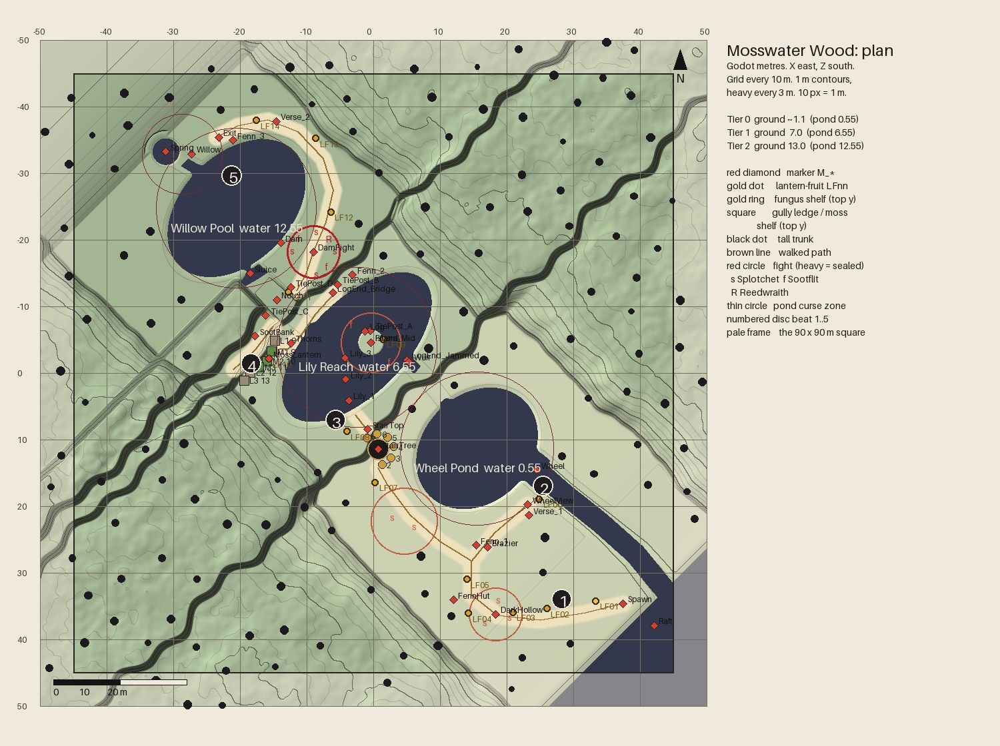
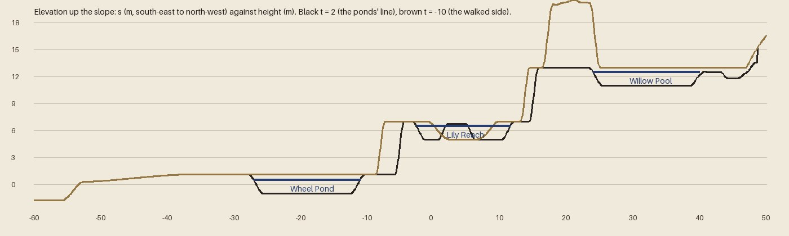

# Mosswater Wood: design

Level 4 of Book One, "The Three Still Ponds" (id `mosswater`, bead *water indigo*). Old forest on a
slope: a stream falls through three ponds that have gone black and still, and under the canopy it
is nearly dark. Orimi lights the way with lantern-fruit, sets each pond moving in turn and blooms
the old willow at the top, and the water and the colour run back down the slope.

Everything placed in the level comes from one file, `tools/levels/mosswater/mw_layout.py`. It
writes `scripts/levels/mosswater/mosswater_layout.json` (markers, ponds, trees, props, lanterns,
fights, curse zones, paths) and the two drawings below. The talk, objectives, warps and autoplay
route are in `scenes/levels/mosswater/level.json`, in the kit's format (docs/LEVEL_KIT.md);
the readable copy of the words is [SCRIPT.md](SCRIPT.md).

## Plan and elevation

Godot metres, X east, Y up, Z south. The slope rises from south-east to north-west. The level is
the 90 x 90 m square |x|, |z| <= 45; the river runs along the south-east corner, and the ground
outside the square rises into a wooded bowl that closes the view.

| Tier | Ground | Pond | Water | Size |
| - | - | - | - | - |
| 0 | 1.1 m | Wheel Pond | 0.55 | 16 x 20 m |
| 1 | 7.0 m | Lily Reach (with the island) | 6.55 | 14 x 28 m |
| 2 | 13.0 m | Willow Pool, held by the dam | 12.55 | 16 x 24 m |
| spring | 13.2 m | the spring under the willow | 13.15 | 4 m |

Each step between tiers is a 6 m bank of rock, too steep to climb except where the level gives a
way up: the stair tree (tier 0 to 1), the gully (tier 1 to 2). Fenn's goat path round the east
side is shown for story only and is blocked at both ends by rock.

## Route, beat by beat

1. **The dark path in** (M_Spawn to M_Fenn_1, about 40 m). Pell lands the raft. LF01 is lit above
   the landing; LF02 is the first unlit lantern-fruit, 11 m along, where the Kindle prompt shows.
   Kindle it and the path ahead shows as a line of hanging husks. At the dark hollow, lighting
   LF03 reveals three Splotchets that were sitting in the dark: a short sealed ambush
   (Fight_Hollow). LF04 and LF05 lead to Fenn's brazier, the first ground that is always lit.
   Fenn talks (he is wary) and names the wheel.
2. **Wheel Pond** (M_Fenn_1 to M_WheelView, 15 m). The first verse-stone sits on the wheel path.
   The paddle-wheel at the outfall is packed with soot; a Gust from M_WheelView clears it, the
   wheel turns and Wheel Pond moves again (still dark water, no colour yet). Fenn thanks Orimi,
   sends her up the stair tree and leaves by the goat path. Two roaming Splotchets on the shore
   path keep the walk to the stair tree from being empty.
3. **Lily Reach** (M_StairTree to M_Fenn_2). Six fungus shelves spiral up the stair tree's trunk,
   1 m apart: five jumps to the bank top. Fenn calls from the far shore, his light 23 m away
   across black water. The still water is deep and will not hold Orimi. Three lily buds lie in a
   line toward the island; Bloom opens each into a 2.4 m leaf platform. Two Sootflits circle 4 m
   over the island and dive at Orimi on the pads; a Gust drops them, a Slash finishes them. The old
   footbridge log is jammed in the weir: a Tie between the post on the island and the post on the
   north shore swings it across into a bridge, the weir runs, and Lily Reach moves. On the north
   shore Fenn tells the story of the Ink-maker's charcoal.
4. **The gully and the dam** (M_Thorns to M_DamFight, a 6 m climb in about 20 m). All four glyphs
   in one short climb: Slash the thorn gate at the foot; Kindle LF10, and three moss shelves unfurl
   toward its light (with a rock ledge below and two above, a staircase of six steps); Gust the
   soot bank off the top; Tie the posts on either side of the gap over the spillway notch to make
   a crossing. The dam crest is a 4 m sealed ring (Fight_Dam), two waves: the crest is about 8.5 m
   across between the parapet and the drop to Lily Reach, so the whole ring stands on it. Winning lifts the sluice
   gate.
5. **The willow** (M_DamFight to M_Willow, about 30 m round Willow Pool). The second verse-stone,
   then Fenn at the willow. Bloom the willow: leaf streamers drop through its crown, the spring
   opens, and the water runs pond by pond down the slope (Willow Pool, the weir, Lily Reach, the
   wheel, Wheel Pond, the river), with the colour and the light following it. The dark lifts.
   Pell calls from the raft. Once the water has run (`water_runs`), the raft at Willow Pool's south
   shore takes Orimi (the LevelExit, 2.5 m) and the level ends.

## Where each glyph is needed

| Glyph | Where | Target | Flag |
| - | - | - | - |
| Kindle | path in (LF02 to LF05), every pond, the gully | lantern-fruit LF02 to LF14 | lit_lfNN |
| Kindle (required) | dark hollow, gully | LF03 (ambush), LF10 (moss shelves) | lit_lf03, lit_lf10 |
| Gust | Wheel Pond | WheelSoot at M_Wheel | wheel_freed |
| Gust | gully top | SootBank | soot_cleared |
| Gust | Lily Reach, dam | Sootflits (knocks them down) | |
| Bloom | Lily Reach | Lily_1, Lily_2, Lily_3 | lily_n_open |
| Bloom | the willow | Willow (Zone_spring, finale) | restored_spring |
| Tie | Lily Reach | TiePost_A to TiePost_B (swings the log) | tied_log |
| Tie | gully | TiePost_C to TiePost_D (the gap) | tied_gap |
| Slash | gully foot, every fight | Thorns, finishing strokes | thorns_cut |

## Fights

| Id | Where | Kind | Enemies |
| - | - | - | - |
| hollow | M_DarkHollow, r 4 m | sealed ambush, starts when LF03 is lit | 3 Splotchets |
| shore | shore path below the stair tree | roaming | 2 Splotchets |
| island | over the island, r 4.5 m | roaming, airborne | 2 Sootflits |
| dam | M_DamFight, r 5 m | sealed, needs tied_gap | wave 1: 4 Splotchets, 1 Sootflit; wave 2: 2 Sootflits, 1 Reedwraith |

Spawn positions are in the layout JSON (`fights`).

### The Sootflit (new enemy)

A drop of ink that grew soot wings, about 0.9 m across the wings. It circles out of reach at about
4 m, and every few seconds dives at Orimi along a shallow curve, then climbs back. A Gust anywhere
on it knocks it out of the air: it falls (`fall`), lies stunned for about 3 s (`downed`, a feeble
flap), and can be hit; if left, it lifts off again. Model `assets/levels/mosswater/mw_sootflit.glb`
(288 tris, 512 px atlas), wrapper `scenes/levels/mosswater/models/mw_sootflit.tscn`, stepped
12 fps animations `idle`, `fly`, `dive`, `hurt`, `fall` and `downed` (idle, fly and downed loop).
The enemy is `scripts/levels/mosswater/sootflit.gd`, an EnemyBase on the kit's flyer hooks: it
spawns at its 4 m altitude (`spawn_height`), never keeps to the ground (`keeps_to_ground` false)
and falls under gravity only once a Gust has downed it (`_apply_gravity`). Self-test:
`scenes/levels/mosswater/sootflit_test.tscn` with `selftest=1`.

## People and verse-stones

| Who | Where | When |
| - | - | - |
| Pell | M_Raft | arrival and departure (shared model `scenes/models/folk/pell.tscn`) |
| Fenn | M_Fenn_1, by the brazier | beats 1 and 2; hidden from reached_cp_stair_top (the stair-top checkpoint) |
| Fenn | M_Fenn_2, north shore of Lily Reach | FennLedge: from reached_cp_stair_top until fight_dam (across the water until tied_log) |
| Fenn | M_Fenn_3, at the willow | FennWillow: from fight_dam; fenn_farewell once restored_spring |
| verse-stone 1 | M_Verse_1, on the wheel path | |
| verse-stone 2 | M_Verse_2, above Willow Pool | |

**Fenn**, the charcoal-burner, is made with the shared folk generator from
`tools/levels/mosswater/folk.json`: adult, stout, apron over a tunic, a rust scarf, a bucket for
the charcoal, the ash palette darkened to soot grey (garment #55524c, trim #8c7b5c, scarf
#6e3b2c, skin #e6d9be). Output: `assets/levels/mosswater/folk/fenn.glb` (588 tris, 512 px woken
and faded atlases) and `scenes/levels/mosswater/folk/fenn.tscn`. He is never faded; he kept the
dark off with his fire.

## Sight lines

- **Arrival** (M_Spawn, looking north-west): the stream bed runs straight toward Wheel Pond and the
  wheel, LF01's light pool sits on the landing, and the line of husks marks the path into the
  dark hollow. In the restored state the Lily Reach fall shows white through the trunks at 30 m.
- **Fenn's brazier** is the brightest thing on tier 0 and can be seen from the dark hollow, so the
  first goal is a light, not a prompt.
- **M_WheelView**: the wheel in the foreground, Wheel Pond, and the stair tree's shelves on the
  bank 25 m beyond: the next goal is in view while doing this one.
- **M_StairTop**: the whole of Lily Reach, the three buds in a line to the island, the jammed log
  and Fenn's light on the far shore.
- **Dam crest** (M_DamFight): down the slope over Lily Reach and Wheel Pond, and across Willow Pool
  to the willow.
- **Finale** (`Curse/FinaleCam`, a fixed CameraZone switched on when the willow blooms and off
  5 s after `water_runs`; the bead narration comes 3 s after it): from 4.5 m above the dam crest,
  over the open sluice and Willow Pool to Orimi, small on the far shore, and the willow.

## Darkness and light

The dark is render's shared light pools (`LightPools`, docs/SHADERS.md "Light pools") with
`set_darkness(1.0)` (`MwBuilder.make_darkness`). Mosswater feeds it lights: lit lantern-fruit
(7.5 m), the brazier (5 m), Orimi's own faint glow (3.4 m) and each moving pond. Over the gully
(`tied_gap`) the dark thins to 0.7. The ponds' black ink is three `MwPondInk` areas
(`Curse/InkLow`, `InkMid`, `InkHigh`, scripts/levels/mosswater/mw_pond_ink.gd) that share
CurseField's slots with the spring's CursedZone through the kit's CurseSlots, drawn without the
Spill's walls.

The finale lifts the wood as soon as the willow blooms: the dark eases to 0.3 over 2.5 s, a warm
16 m pool of light falls through the willow, and the valley gloom goes over 3 s. Then the water
runs pond by pond (Willow Pool, Lily Reach, Wheel Pond, 1.6 s apart): each pond's ink clears
and its light comes up, the dark goes to 0, every lantern-fruit lights and `water_runs` is set.
The bead narration follows on `ponds_remember`.

## Deep water

Each pond is a kit DeepWater (`Water/PondLow`, `Water/PondMid`, `Water/PondHigh`): a box on the
pond ellipse's axes, top at the waterline, `sink` 0.1 m (the kit counts feet up to 0.05 m over the
surface as in at `sink` 0, and Lily Reach's north-west shore and an open lily pad sit 0.05 m over
it) and `bank_height` 0.03 m, so the island (0.17 m over the water) and an open pad count as bank.
Orimi who steps off the bank, the island, the log or an open pad into the deep bowl is put back
at least 0.8 m onto the ground she left, unhurt; a closed bud has no pad to stand on. The box's corners lie on the dry bank (0.45 m over the
water) except at Wheel Pond's outlet, where the river bed below the waterline counts as water
too. The ponds stay deep after the finale. The post-dam route checks it with `probe_water`, pushing
into Willow Pool from the raft's shore for 2 s (elsewhere the island Sootflits and the shore Splotchets
reach Orimi during the probe).

## First play time

About 10 minutes: walking and climbing 3 min (roughly 260 m of route, six fungus shelves and six
gully steps), talk 2.5 min (52 panels at about 3 s each), fights 3 min (hollow, island, dam with two waves), glyph
puzzles 1.5 min. The range is 8 to 12 minutes.

## Changes from LEVELS.md, and why

- **Fenn moves**: he stands at three places (brazier, north shore, willow), each further up. The
  brief says he "helps more with each pond"; moving up with Orimi makes that visible and puts a
  light ahead of her at every stage.
- **The dark hollow is an ambush.** The brief says the dark hides Splotchets; lighting LF03 reveals
  them and starts a sealed fight, so the first Kindle has a consequence the player sees.
- **The log is jammed in the weir.** The Tie both makes the bridge and unjams the weir, so the one
  action moves the middle pond.
- **Each pond moves when its puzzle is done, but stays dark** (no colour); the colour comes down
  with the water at the end. This keeps the brief's beat 5 as the payoff while giving each pond its
  own sound and motion.
- **Two verse-stones** in the Ink-maker's voice, one low and one high, carry the charcoal story
  from his side.
- **The gully staircase** is how "all four glyphs in one short climb" is built: Slash, Kindle,
  Gust and Tie in that order, each one opening the next step.
- **The dam fight mixes enemies** (Splotchets, Sootflits, a Reedwraith), so the Sootflit's Gust
  answer is tested under pressure.

## Markers

| Marker | Position (x, y, z) | What |
| - | - | - |
| M_Spawn | 37.5, 0.3, 34.6 | Orimi steps off the raft, facing the dark hollow |
| M_Raft | 42.1, -0.3, 37.9 | Pell's landing on the river; the raft leaves from here |
| M_DarkHollow | 18.4, 1.1, 36.2 | the unlit dip in the path; ambush when LF03 is lit |
| M_FennHut | 12.0, 1.1, 34.1 | Fenn's hut |
| M_Fenn_1 | 15.4, 1.1, 25.9 | Fenn at his brazier (beats 1 and 2) |
| M_Brazier | 17.1, 1.1, 26.2 | the brazier: a 5 m pool of light that never goes out |
| M_Verse_1 | 23.3, 1.1, 21.4 | first verse-stone, on the wheel path |
| M_Wheel | 24.5, 0.6, 14.6 | the paddle-wheel at Wheel Pond's outfall (Gust) |
| M_WheelView | 23.2, 1.1, 19.8 | where Orimi stands to Gust the wheel |
| M_PondLow | 15.6, 0.6, 11.3 | Wheel Pond centre, water 0.55 |
| M_PondMid | -2.5, 6.5, -3.9 | Lily Reach centre, water 6.55 |
| M_PondHigh | -20.5, 12.6, -24.7 | Willow Pool centre, water 12.55 |
| M_StairTree | 0.7, 1.1, 11.5 | the stair tree: six fungus shelves spiral up 1 m apart |
| M_StairTop | -0.8, 7.0, 8.5 | top of the bank at Lily Reach |
| M_Lily_1 | -3.7, 6.5, 4.1 | lily bud 1 (Bloom: a platform) |
| M_Lily_2 | -4.1, 6.5, 1.0 | lily bud 2 |
| M_Lily_3 | -4.2, 6.5, -2.3 | lily bud 3 |
| M_Island | -0.4, 6.7, -4.6 | the island under the sootflits |
| M_TiePost_A | -0.4, 6.7, -6.4 | tie post on the island |
| M_Log | -1.2, 6.6, -6.3 | the log's root plate (its pivot) |
| M_LogEnd_Jammed | 5.1, 6.5, -2.0 | the log's far end, jammed in the weir |
| M_LogEnd_Bridge | -6.1, 7.0, -12.0 | the log's far end once tied: a bridge to the north shore |
| M_TiePost_B | -5.4, 7.0, -13.3 | tie post on the north shore |
| M_Weir | 5.4, 6.5, -1.7 | the weir from Lily Reach down to Wheel Pond |
| M_Flyers_Mid | -0.4, 10.8, -4.6 | sootflit orbit centre, 4 m above the island |
| M_Fenn_2 | -3.1, 7.0, -14.7 | Fenn on the north shore (beat 3) |
| M_Thorns | -12.4, 7.0, -4.5 | thorn gate at the gully foot (Slash) |
| M_MossLantern | -15.7, 9.9, -2.1 | LF10 in the gully; its light unfurls moss shelves M1 to M3 |
| M_SootBank | -17.7, 13.0, -5.5 | soot bank at the gully top (Gust) |
| M_TiePost_C | -16.1, 13.0, -8.6 | tie post, west side of the gap |
| M_TiePost_D | -12.4, 13.0, -12.8 | tie post, east side of the gap |
| M_Notch | -14.5, 11.8, -11.0 | the spillway notch under the gap |
| M_DamFight | -9.0, 13.0, -18.2 | centre of the sealed fight on the dam crest |
| M_Dam | -13.9, 13.0, -19.5 | the dam |
| M_Sluice | -18.5, 13.0, -14.9 | the sluice gate; lifts when the dam fight is won |
| M_Verse_2 | -14.6, 13.0, -37.8 | second verse-stone, path above Willow Pool |
| M_Fenn_3 | -21.1, 13.0, -34.9 | Fenn at the willow (beats 4 and 5) |
| M_Willow | -27.2, 13.0, -32.9 | the old willow (Bloom: the finale) |
| M_Spring | -31.1, 13.2, -33.2 | the spring the willow's roots hold, water 13.15 |
| M_Exit | -23.2, 13.0, -35.4 | level end after the finale |

Lantern-fruit LF01 to LF14 are listed in the layout JSON (`lanterns`), with the beat each belongs
to; LF01 starts lit and LF10 unfurls the moss shelves. The stair tree's shelves and the gully's
steps are in `stair_shelves` and `gully`.

## Assets

Generated by `tools/levels/mosswater/gen.sh` (Blender headless and the shared painter), imported
by `tools/levels/mosswater/import.sh`, wrapped by `make_wrappers.py`; provenance in
`assets/levels/mosswater/provenance.json`. Look-dev: `scenes/levels/mosswater/lookdev.tscn`
(`view=arrival|walk|wheel|stair|lily|gully|dam|willow|overview`, `state=drained|restored`,
`lanterns=start|all|none`, `tour=1`; keys 1 to 9, R, L, D).
