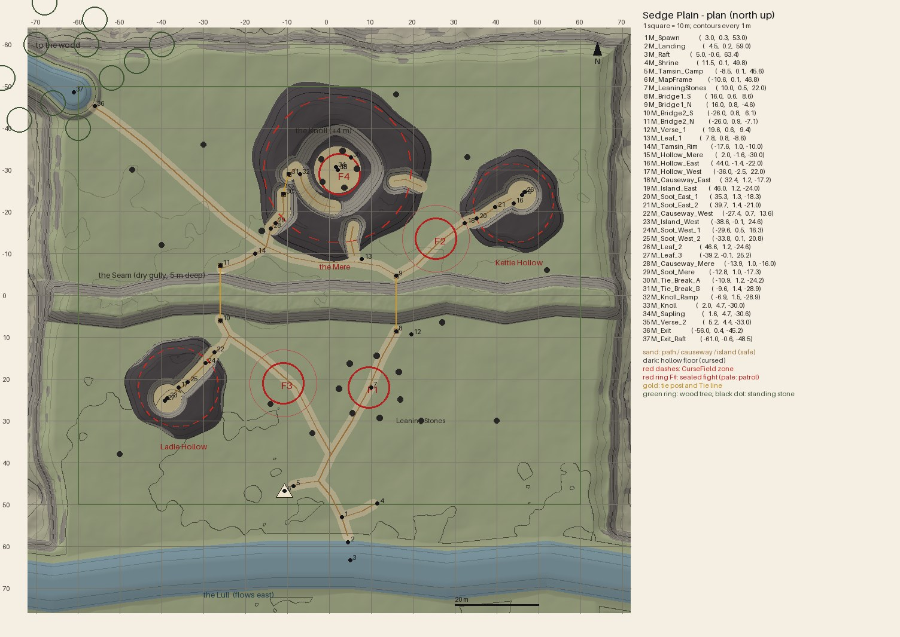

# Level 3: Sedge Plain, "The Mapmaker's Road"

The design of the third level and, since Phase B, the playable level itself
(`scenes/levels/sedge_plain/sedge_plain.tscn`). The plan, the terrain, the markers and the gameplay data all
come from one file, `tools/levels/sedge_plain/layout.py`. Change the layout there and run
`tools/levels/sedge_plain/gen_all.sh`; never edit the generated files by hand. The script is in
[SCRIPT.md](SCRIPT.md), which is generated by `write_script.py`. That file also writes `level.json`.

Axes are Godot's: X points east, Y up, Z south, all in metres. North is up on the plan, and one
grid square is 10 m. The playable plain is 120 by 100 m (x -60..60, z -50..50). Hills surround
it: low foothills Orimi can stand on, a rock band she cannot climb, and grassy shoulders up to a
crest that rises and falls, the river runs along the south edge, and the wood starts past the north-west
corner.

## What is where

- **The landing (south).** Pell's raft comes in on the Lull at `M_Raft`. A small
  shrine stands east of the landing stage, and Tamsin's camp and empty map frame are to the
  west, 15 m from the spawn.
- **The Leaning Stones.** A ring of seven standing stones 30 m north of the landing. The first
  sealed fight is in the middle of the ring.
- **The Seam.** A dry gully 10 m wide and 5 m deep runs east to west across the middle of the
  plain. It has two broken rope bridges: the first at x = 16, with the first verse-stone beside
  it, and the second at x = -26.
- **The Mere.** The largest hollow, 21 m to its rim, centred at (2, -30). The Knoll rises out of
  it as a smooth dome whose flat top is 5.6 m across and stands 4.7 m above the plain. The
  Knoll sapling and the second verse-stone are on the top. Two false spurs of old causeway
  run into the Mere from the south and the east and stop in the black.
- **Kettle Hollow (east) and Ladle Hollow (west).** Each is 12 m to the rim and 2.5 m deep. A
  soot-buried causeway leads to an island of clean ground in each one, and a map leaf lies on
  each island.
- **The exit.** A path leaves the north rim of the Mere and runs north-west to the wood. A brook
  comes out of the wood there and ends in a pool at `M_Exit`, where Pell waits on the raft
  (`M_Exit_Raft`) to pole Orimi on into Mosswater Wood.

## Markers

The table lists the markers the route uses. The authority is `MARKERS` in
`scripts/levels/sedge_plain/sedge_layout.gd`; the same `M_*` Marker3D nodes sit under
`Markers` in `scenes/levels/sedge_plain/terrain.tscn`, at ground height.

| Marker | x | y | z | Use |
| - | - | - | - | - |
| `M_Spawn` | 3.0 | 0.35 | 53.0 | Orimi starts here, facing `M_Knoll` |
| `M_Landing` | 4.5 | 0.25 | 59.0 | Landing stage |
| `M_Raft` | 5.0 | -0.60 | 63.4 | Pell's raft on arrival |
| `M_Shrine` | 11.5 | 0.11 | 49.8 | Shrine |
| `M_Tamsin_Camp` | -8.5 | 0.07 | 45.6 | Tamsin, until bridge 1 is tied |
| `M_MapFrame` | -10.6 | 0.07 | 46.8 | The empty map frame (tamsin_camp prop) |
| `M_LeaningStones` | 10.0 | 0.52 | 22.0 | Centre of the stone ring |
| `M_Fight_1` | 9.5 | 0.53 | 22.0 | Sealed fight: Fight_Stones |
| `M_Fight_2` | 25.5 | 1.03 | -13.5 | Sealed fight: Fight_East (knot drifts 3 m) |
| `M_Fight_3` | -11.0 | 0.36 | 21.0 | Sealed fight: Fight_West (knot drifts 3 m) |
| `M_Fight_4` | 2.5 | 4.73 | -29.0 | Sealed fight: Fight_Knoll |
| `M_Bridge1_S` / `M_Bridge1_N` | 16.0 | 0.59 / 0.76 | 8.6 / -4.6 | Tie posts, bridge 1 |
| `M_Bridge2_S` / `M_Bridge2_N` | -26.0 | 0.81 / 0.92 | 6.1 / -7.1 | Tie posts, bridge 2 |
| `M_Verse_1` | 19.6 | 0.59 | 9.4 | Verse-stone 1 (teaches Tie) |
| `M_Leaf_1` | 7.8 | 0.83 | -8.6 | Map leaf 1, on the Mere's south rim |
| `M_Tamsin_Rim` | -17.6 | 0.98 | -10.0 | Tamsin, from bridge 1 onwards |
| `M_Hollow_Mere` | 2.0 | -1.61 | -30.0 | Zone centre, the Mere (CurseField slot 2) |
| `M_Hollow_East` | 44.0 | -1.43 | -22.0 | Zone centre, Kettle Hollow (slot 1) |
| `M_Hollow_West` | -36.0 | -2.54 | 22.0 | Zone centre, Ladle Hollow (slot 0) |
| `M_Causeway_East` | 32.4 | 1.22 | -17.2 | Start of the Kettle Hollow causeway |
| `M_Soot_East_1` / `_2` | 35.3 / 39.7 | 1.28 / 1.37 | -18.3 / -21.0 | Soot banks (Gust) |
| `M_Island_East` | 46.0 | 1.21 | -24.0 | Island, Kettle Hollow |
| `M_Leaf_2` | 46.6 | 1.25 | -24.6 | Map leaf 2 |
| `M_Causeway_West` | -27.4 | 0.66 | 13.6 | Start of the Ladle Hollow causeway |
| `M_Soot_West_1` / `_2` | -29.6 / -33.8 | 0.53 / 0.12 | 16.3 / 20.8 | Soot banks (Gust) |
| `M_Island_West` | -38.6 | -0.12 | 24.6 | Island, Ladle Hollow |
| `M_Leaf_3` | -39.2 | -0.11 | 25.2 | Map leaf 3 |
| `M_Causeway_Mere` | -13.9 | 1.02 | -16.0 | Start of the Mere causeway, by the leaning post |
| `M_Soot_Mere` | -12.8 | 1.04 | -17.3 | Soot bank, which stays until Tamsin reads the map |
| `M_Tie_Break_A` / `_B` | -10.9 / -9.6 | 1.23 / 1.36 | -24.2 / -28.9 | Tie posts across the break in the causeway |
| `M_Knoll_Ramp` | -6.9 | 1.51 | -28.9 | Foot of the spiral ramp up the Knoll |
| `M_Knoll` | 2.0 | 4.74 | -30.0 | Top of the Knoll |
| `M_Sapling` | 1.6 | 4.73 | -30.6 | Knoll sapling (Level 1's sapling at 4.5x) |
| `M_Verse_2` | 5.2 | 4.42 | -33.0 | Verse-stone 2 |
| `M_Exit` | -56.0 | 0.37 | -45.2 | LevelExit, on the bank of the brook's pool |
| `M_Exit_Raft` | -61.0 | -0.60 | -48.5 | Pell's raft in the pool |

## The route, beat by beat

Each beat names the glyphs it needs. Slash is needed for every fight and the finishing stroke.

0. **Arrival.** Pell's raft reaches the landing (`pell_arrival`). From the spawn the camera
   faces north, up the path to the Leaning Stones, with the Knoll and its sapling behind them.
1. **Tamsin.** Tamsin is camped 15 m west of the spawn. She tells Orimi that the first leaf went
   north, past the stones, toward the Seam. The path to the stones crosses **Fight_Stones**,
   which teaches the finishing stroke (glyph: Slash).
2. **First bridge.** Verse-stone 1 stands by the broken bridge at x = 16 (glyph: Bloom). Its
   four lines teach Tie, and a Tie between the two posts makes the bridge (glyph: Tie). Tamsin
   then walks over the bridge and waits at `M_Tamsin_Rim` for the rest of the level, so the
   player never has to cross back to the camp.
3. **First leaf.** Leaf 1 lies on the Mere's south rim, 10 m past the bridge. Tamsin names the
   Mere and the Knoll and sends Orimi east. The two false spurs into the Mere are visible from
   here; walking out on either one ends in the black with a card (`spur_dead_end`).
4. **Kettle Hollow.** The east path passes **Fight_East**, a roaming pack. Two soot banks bury
   the causeway (glyph: Gust). Leaf 2 lies on the island.
5. **Ladle Hollow.** Tamsin sends Orimi west. The way crosses the Seam at bridge 2, which needs a
   second Tie (glyph: Tie); the long way round, back over bridge 1, is also open. **Fight_West**
   waits on the path north of bridge 2, 13 m clear of the Seam. Two soot banks (Gust) lead to Leaf 3 on the island.
6. **The map.** Tamsin reads all three leaves: in by the leaning post, two bends, then tie the
   gap. Only now will the soot at `M_Soot_Mere` move (glyph: Gust).
7. **The Mere.** Orimi follows the causeway, ties the break (glyph: Tie) and climbs the ramp to
   the Knoll. **Fight_Knoll** is two pulses on the top. Verse-stone 2 (Bloom) can be read before
   or after the fight.
8. **Restoration.** A Bloom on the sapling restores the Mere, and the colour then sweeps Kettle
   Hollow and Ladle Hollow in turn (glyph: Bloom). Tamsin finishes her map: the river all the way
   to the wood, and a blank where the kiln is.
9. **Exit.** The path runs north-west to the brook's pool at `M_Exit`, where Pell is waiting on
   the raft (`pell_exit`). The end card names the plain as drawn again (`end_text`).

Kindle is not needed in this level.

## Fights

| Fight | Where | Ring | Pack |
| - | - | - | - |
| Fight_Stones | `M_Fight_1`, in the Leaning Stones | 5 m, fixed | 4 Splotchets; teaches the finishing stroke |
| Fight_East | `M_Fight_2`, east path | 5 m, knot drifts 3 m | 3 Splotchets, 1 Reedwraith |
| Fight_West | `M_Fight_3`, north of bridge 2 | 5 m, knot drifts 3 m | 3 Splotchets, 2 Reedwraiths |
| Fight_Knoll | `M_Fight_4`, top of the Knoll | 5 m, fixed | Pulse 1: 4 Splotchets, 1 Reedwraith; pulse 2: 2 Reedwraiths, 2 Splotchets |

That is 22 enemies in total, the most of any level so far. The CursedZones themselves start empty.

Fight_West moved from (-17.5, 15) in Phase B. There, its Reedwraiths circled out over the Seam
and fell in, where Orimi could not reach them. The fight knots drift 3 m, not 4 or 5, so the
knot stays within reach as Orimi runs up.

## People and verse-stones

- **Tamsin.** Generated with the folk generator from `tools/levels/sedge_plain/folk.json`:
  adult, slim, tunic, wide-brimmed hat, carrying a scroll, ash palette with a straw hat and a
  sedge-green trim. The model is 552 tris with a 512² woken atlas and a faded atlas, and the
  wrapper is `scenes/levels/sedge_plain/folk/tamsin.tscn`. She stands at `M_Tamsin_Camp`, then
  at `M_Tamsin_Rim`. She is never faded: the Spill has not reached the camp. Her talk ids
  change with progress: `tamsin_meet`, `tamsin_rim`, `tamsin_two_leaves`, `tamsin_map`,
  `tamsin_after`, each with an `_again` line where one exists.
- **Pell.** Uses the shared `folk/pell` model and `scenes/models/raft.tscn`. Pell is not in
  this level's folk spec.
- **Verse-stones.** Two: `M_Verse_1` by bridge 1, and `M_Verse_2` on the Knoll. Each has four
  lines, with the ids `verse_1` and `verse_2`.

## Sight lines

- **From the spawn** (desktop and browser captures under "Look-dev"): the sand path runs north
  through the sedge to the Leaning Stones. Behind them the Knoll shows as a pale green dome
  with red curse light on both sides. From 85 m the sapling is only a small dark mark on top,
  and it is clearer on the skyline once Orimi reaches the stones.
- **From the stones and bridge 1:** the Knoll, the red rim of the Mere, and Tamsin's rim spot.
- **From the hollow rims:** each island and its leaf can be seen across the black, so the goal
  is clear before the causeway is uncovered.
- **From the Knoll:** the whole plain, with both small hollows. This is where the restoration
  sweep is staged.

## Play time

Browser autoplay, which runs the shortest route and clicks through every line at once, finishes
in about 4.5 minutes; a player who reads and looks around takes about twice that. The original
estimate follows. The route is about 465 m in straight lines,
so about 580 m on the paths, which takes about 1.5 minutes at Orimi's run speed of 6.4 m/s.
The other parts are about 4 minutes for four fights with 22 enemies, about 3 minutes of talk
(607 words) and about 1.5 minutes for the glyph puzzles (three Ties, five soot banks, three
Blooms). Looking around and the false spurs add about 1 minute. The total is about 10 to 11
minutes. If fights run short, Fight_West is the one to make larger.

## Changes from docs/LEVELS.md, and why

- **Named places.** The brief left them unnamed. They are now the Seam (the gully), the Mere,
  the Knoll, Kettle Hollow and Ladle Hollow. Thimble Hollow was rejected because it collides
  with a board game called Thimble's Hollow.
- **Tamsin moves to the rim** once bridge 1 is tied. Otherwise each leaf would mean walking back
  over the Seam to the south camp.
- **A fourth sealed fight, on the Knoll.** The brief asks for two or three roaming fights and
  "the most fighting so far". The three plain fights stay, and the Knoll fight is the climax
  before the bloom.
- **False spurs in the Mere and a soot bank that stays until the map is read.** These turn
  "Tamsin can read the way" into a real gate: without the map the player sees roads that go
  nowhere.
- **Leaf 1 is on the Mere's rim, not inside a hollow.** It teaches what the leaves look like
  before any causeway puzzle.
- **Pell leaves by raft.** A brook and a pool were added at the exit, so Pell arrives and leaves
  on water, as every level does.
- **Names.** The river is the Lull, the mapmaker is Tamsin and the ink's maker is the
  Ink-maker.

## How the kit learns safe ground

The level gives the kit three things, all generated from the same layout as the terrain:

1. `SedgePlainLayout.HOLLOWS` gives each hollow's centre, zone radius, rim radius, floor height
   and CurseField slot.
2. `SedgePlainLayout.SAFE_LINES` gives the causeways, the spurs and the Knoll ramp as polylines
   with a half width. `SAFE_DISCS` gives the two islands and the Knoll plateau.
3. `SedgePlainLayout.is_kept_out(p)` returns true inside a hollow's rim when p is not safe.
   `is_safe(p, margin)` and `hollow_at(p)` are also there.

On screen, the safe ground is a separate mesh (`Safe` in terrain.tscn) whose InkLook has
`cursable = false`, so the curse never paints it. Phase B can hand the kit either the functions
above, for example as a callable passed to the coming "ground that keeps you out" node, or the
mesh in a `safe_ground` group. Which one is the gameplay workstream's choice.

## Phase B: the playable level

`tools/levels/sedge_plain/make_level.py` writes `sedge_plain.tscn` from the layout. `write_script.py`
writes `level.json` (objectives, lines, warps, the raft, `end_text`, safe ground and the autoplay
route). `scripts/levels/sedge_plain/sedge_plain.gd` adds the sedge, mist and wood, registers the
level music (`sedge_plain_cursed`, `sedge_plain_restored`), counts the leaves, and runs the
finale. Everything else is kit nodes:

| Node | Kit part | Settings |
| - | - | - |
| `Pell` | Person | `pell_arrival` on the landing stage |
| `Tamsin`, `Tamsin_Rim` | Person | Tamsin hides on `tied_bridge_1`, Tamsin_Rim shows on it; talk_by_flag leaf_1, leaves_two, leaves_all, restored_mere |
| `Fight_Stones`, `Fight_East`, `Fight_West`, `Fight_Knoll` | SealedFight | fight_id stones, east, west, knoll |
| `Zone_mere` | CursedZone | finale, restored by the sapling; `run_finale` then sweeps `Zone_east` and `Zone_west` |
| `Bridge_1`, `Bridge_2`, `Mere_Gap` | TiePost pairs (`PostA`, `PostB`) | action bridge, width 3.4 m; flags tied_bridge_1, tied_bridge_2, tied_mere_gap |
| `Verse_1`, `Verse_2` | VerseStone | Verse_1 teaches Tie |
| `Soot_East_1/2`, `Soot_West_1/2`, `Soot_Mere` | GlyphObstacle (gust) | each needs its fight won; Soot_Mere needs `talked_tamsin_map` |
| `Ground_mere`, `Ground_east`, `Ground_west` | CursedGround | safe ground from `level.json`; cleared by restored_<zone> |
| `Leaf_1..3` | Pickup | flags leaf_1..3, model map_leaf, radius 1.4; the level plays the card lines `leaf_1..3` |
| `Checkpoint_Rim`, `Checkpoint_Mere` | Checkpoint | |
| `LevelExit` | LevelExit | at the brook's pool, needs restored_mere |

The tie posts are plain TiePost nodes under a Node3D holder, not `tie_posts.tscn` instances with
their children overridden. The web export dropped those overrides, so in the browser every pair
stood at the kit's default spot near the world origin. A hand-written scene needs an
`[editable path="..."]` line for such overrides; gameplay's `tools/game/check_scenes.sh` checks
for it.

Every part of the level uses a kit part that exists, and no stand-in is left. Not used:
DeepWater (the Lull and the brook are scenery, and the exit is by raft), Tie `catch`,
RisingHazard and the flyer movement hooks.

Proof: `tools/game/web_autoplay.sh level=sedge_plain` on a fresh export plays every stage from
the spawn to the end card and back to the title. `tools/game/autoplay_headless.sh
level=sedge_plain` plays the same route.

## Look-dev

`scenes/levels/sedge_plain/lookdev.tscn` shows the terrain, the dressing, Tamsin and the card
foliage, which is 700 cards per tile across 16 tiles (11,290 cards). Boot options are listed at
the top of `scripts/levels/sedge_plain/lookdev.gd`.

- Desktop: [lookdev_desktop.jpg](lookdev_desktop.jpg) (landing, camp, stones, knoll, rim and
  high views). It ran at roughly 90 to 140 fps.
- Browser (1280x720, headless Chrome on the real GPU, fresh export of this worktree):
  [lookdev_web.jpg](lookdev_web.jpg) and [web_smoke_landing.txt](web_smoke_landing.txt).
  After warm-up the landing view ran at 113 to 133 fps; the high, knoll, camp and mere views ran
  at 120 to 144 fps, where the display caps them. All five passed with no errors.

## Budget

- **Terrain:** 16 ground tiles of 2,592 tris each, hills at 4,338, the safe skin at 1,394 and
  the river at 240.
- **Props:** 68 to 692 tris each. Tamsin is 552.
- **Textures:** ground 2048², hills 1024², props 512² (tamsin_camp is 1024², map_leaf is 256²).
- **Size added to the export:** about 2.2 MB in index.pck (2.09 MB of imported resources with
  lossy-compressed textures, plus 0.09 MB of scenes, scripts and data). The source files on disk
  are 7.0 MB.

## Open questions

- **Cursed-ground push-back in the route.** The route's `probe_cursed` step comes back once
  gameplay's fix to it is on main.
- **The Knoll's shape.** From the hollow rims, the cursed slopes below the Knoll still read as
  grey cliff faces. From the landing and the top it reads as a dome.
