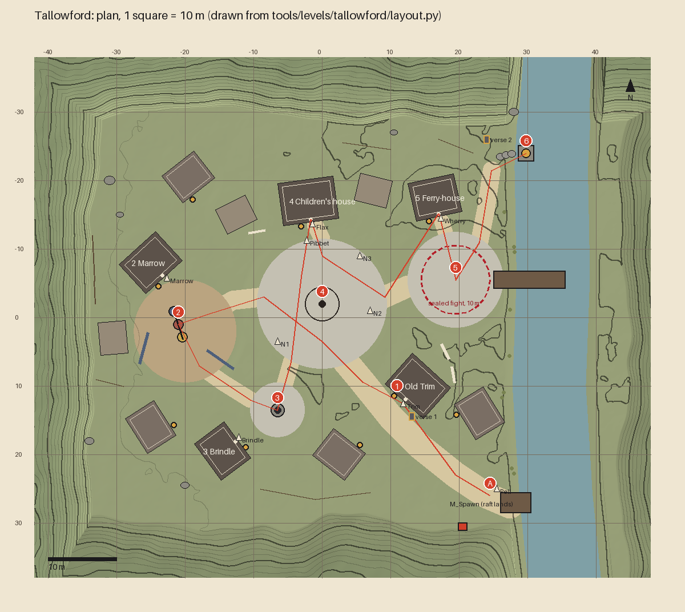

# Tallowford: level design ("The Lamps of Tallowford")

Level 2 of Book One. Level id `tallowford`. Owner: the l2 workstream. This expands the Level 2
section of docs/LEVELS.md into something a builder can place objects from. Every coordinate here
comes from `tools/levels/tallowford/layout.py`, the same module the terrain generator, the ground
painter and the plan image read; the tables marked "generated" are rewritten from it by
`tools/levels/tallowford/docs.py`, and phase B loads the same data from
`scripts/levels/tallowford/layout.json`. Metres, Godot axes: X east, Y up, Z south (north is -Z).

The plan is drawn to scale from the layout (`tools/levels/tallowford/plan.py`): ground tint and
0.5 m contours from the height field, paths, the two paved squares, the dye yard, houses (dark,
numbered by beat), neighbours' cottages (mid grey, outlined), sheds (pale), lamps (gold dots),
people (white triangles), verse-stones (grey with a gold edge), the sealed-fight circle (dashed
crimson), and the route (red line, beats in red discs, A = arrival). One grid square is 10 m.

## The place in one paragraph

A lamp-makers' village in a shallow bowl on the west bank of the Lull, at dusk. Low houses
with paper screens and dark timber, a lamp post by every door, racks of lantern paper drying, a dye
yard of steaming vats and hanging cloth. The square in the middle has a bare persimmon. The river
runs north to south along the east side; a jetty and its paved square sit on the bank, and the
ford-lamp stands on a stone pier in the shallows to the north-east, the tallest thing in the
village, visible from every street. Hills close the bowl to the west, north and south. Pell's raft
lands at stone steps in the south-east and the road climbs north-west into the village.

## Size and shape

- Playable ground: about 62 by 62 m inside the hills (x from -33 to the riverbank at about 27,
  z from -30 to 31). The whole bowl to the hill crests is about 80 by 66 m. The river is 9 m wide
  (water at y = -0.35, bed at -1.6) with a 2.5 m bank either side.
- Ground: the village floor is near y = 0, rising gently westward (about 0.5 m at the dye yard)
  and toward the southern fields. Paths keep the slope but lose the bumps. Every building sits on a
  level pad. The squares are flat and paved (village square y = 0, jetty square y = 0.1).
- Edges: hills rise 9 to 16 m beyond x = -33 (west), z = -29 (north) and z = 30 (south); the far
  bank rises beyond x = 44. The river itself is the east edge: the player can wade the shallows
  (phase B: the same wading floor as Level 1) but the far bank's slope keeps them in.

## Route, beat by beat

The order is the one in docs/LEVELS.md. Each villager wakes when their lamp is lit and points to
the next. Walking speed is 6.4 m/s; a first play takes about 10 minutes.

| Beat | Where | What the player does | Glyphs | Wakes | Points to | First-play time |
| - | - | - | - | - | - | - |
| A | M_Spawn, the landing (24.5, 26) | Steps off the raft; Pell's four lines; walks 18 m up the road. | | | Old Trim | 0:00 to 0:40 |
| 1 | Old Trim's house (14, 10) | Talks to grey Trim, blooms verse-stone 1 beside his lamp (learns Kindle), kindles his lamp. Colour spreads 6 m round the lamp. Trim wakes, tells of the ink-maker who bought his lamp-black. | Bloom, Kindle | Old Trim | Marrow, west | 0:40 to 2:30 |
| 2 | Dye yard (-20, 2) and Marrow's house (-25, -8) | Crosses the square west (35 m). Ink thorns knot the three vats: Slash. Kindles Marrow's lamp. | Slash, Kindle | Marrow | Brindle, the well | 2:30 to 4:00 |
| 3 | The well (-6.5, 13.5) and Brindle's cottage (-14.5, 19.5) | Takes the lane south-east (18 m). Soot packs the well: Gust. Kindles Brindle's lamp. | Gust, Kindle | Brindle | the children | 4:00 to 5:20 |
| 4 | The square (0, -2) and the children's house (-2, -17) | Walks north into the square (16 m). Blooms the bare persimmon. Kindles the children's lamp. | Bloom, Kindle | Flax and Pibbet | Aunt Wherry, ferry-house | 5:20 to 6:50 |
| 5 | Ferry-house (16.5, -17.5), jetty square (19.5, -5.5) | Walks east (22 m). Kindles the ferry-house lamp: the Spill rises from the river under the jetty. The first sealed fight, on the jetty square. Wherry wakes after it. | Kindle, Gust (veil), Slash, swipes | Aunt Wherry | the ford-lamp | 6:50 to 9:20 |
| 6 | The ford-lamp (29.8, -24) | Walks the north path (20 m). Optional verse-stone 2 at the causeway head. Gusts the soot hood off, kindles the wick high on the post. The finale: every lamp flares, colour returns, everyone gathers at the jetty. Talk to Pell to leave. | (Bloom), Gust, Kindle | everyone | Pell, the raft | 9:20 to 11:00 |

Glyph count to finish: Kindle 6 (taught at beat 1), Bloom 2 (verse-stone 1, persimmon; verse-stone
2 optional), Slash 1 plus the fight, Gust 2 plus the Reedwraith's veil. Tie is not used here.

Gating (phase B): a lamp only takes Kindle once its own problem is solved (the vats freed, the well
cleared, the tree bloomed); before that Kindle on it fails gracefully with the narration line in
the script. The ferry-house lamp and the ford-lamp hood are open from the start, but the ford-lamp
wick refuses Kindle until the sealed fight is won. Talking to a grey villager gives a narration
line and nothing else. Lamps of houses not yet reached are still cold; the player can light them
in any order once their problem is solved, but the villagers' directions lead through the order.

## Sight lines and arrival

- **Arrival (M_Spawn, camera facing north-north-west, yaw about 27 degrees west of north).** Left of
  centre, 18 m up the road: Old Trim's house with its cold lamp and the grey verse-stone by the
  door, the first thing to walk to. Centre: the road climbing into dark houses, the bare black
  persimmon above the roofs 33 m away. Right, along the river: the ford-lamp on its post, 50 m
  north, a dark silhouette above the bank, at the right third of the frame. The roadside shrine
  (Level 1's model) is just behind the spawn on the left, the first familiar thing.
- **From the square.** The ford-lamp is 37 m north-east; its lantern (6.6 m up) clears the
  ferry-house ridge (4.2 m) by about 2 degrees of view, so it shows from anywhere in the square.
  Every quest house fronts on the square or a lane leading off it, so each lit lamp's pool reads
  from the middle of the village.
- **From the dye yard and the well.** The persimmon is the middle-distance silhouette; the
  ford-lamp is visible over the children's house and the cottages (low roofs, 3.8 to 4.4 m).
- **The jetty square.** Opens east onto the river with the jetty running 10.5 m out; the ford-lamp
  is 19 m north up the bank, so the fight is framed by the landmark it unlocks.
- **The finale camera** (phase B): when the ford-lamp lights, `FinaleCam` (a fixed CameraZone,
  blending in over 1.5 s) takes over from FordCam: from 7.5 m up over the river north-east of the
  lamp it watches Orimi, small on the causeway, with the lit lantern beside her, the villagers
  gathered by the jetty and the village behind, while the cottages' lamps light one by one.

## The sealed fight (beat 5)

- Centre M_Fight (19.5, 0.1, -5.5), ring radius 5 m (10 m across) on the 14 m paved jetty square.
  Nothing stands inside 6 m of the centre: the ferry-house front is 9.6 m away, the jetty begins
  5.5 m east at deck height 0.15 (flush with the paving), the drying racks and cottages are over
  11 m away. The ring's ink wash and paper screens have a clear flat floor all round.
- The Spill rises from the river beside the jetty: phase B puts CurseField slot 0 on the jetty
  square (centre M_Fight, radius 7) at amount 1 when the ferry lamp is lit and restores it when
  the ring falls, so the paving goes black under red light for the fight and wipes clean after.
- Enemies (kit spawn points on the ring's inner edge, each 3.5 m from the centre):
  1. Pulse 1: four Splotchets hop up out of the water at the jetty's foot and the east edge.
  2. Pulse 2, when two are left: two more Splotchets and one Reedwraith, which drifts in from the
     river side. Its veil teaches nothing new (Level 1 taught it), but it is the first time the
     player meets one in a closed ring.
- Expected length on a first play: 60 to 90 seconds. Ink: the fight starts with the pot full
  (refill on the ferry lamp); every Splotchet refunds ink as in Level 1.

## People and where they stand

Everyone in the village starts grey and still in their doorway, the way docs/LEVELS.md describes,
and wakes when their lamp is lit. The cast is made by the shared folk generator (docs/ASSETS.md,
"Folk") from `tools/levels/tallowford/folk.json`: `tools/assets/gen_folk.sh
tools/levels/tallowford/folk.json` writes `assets/levels/tallowford/folk/<name>.glb`, a woken and a
faded atlas (512 px) and the wrapper `scenes/levels/tallowford/folk/<name>.tscn` (a `FolkPerson`).
Pell is the shared `scenes/models/folk/pell.tscn`. The generator's props are lantern, pole, bucket,
basket and scroll, so a few props from the first draft became the nearest one (Marrow's dye paddle
and Wherry's oar are poles; the net-mender's net is a scroll-shaped roll).

| Person | Marker | Wrapper | Size, build | Garment, hat | Prop | Palette and overrides | Triangles |
| - | - | - | - | - | - | - | - |
| Old Trim, the lamp-maker | M_Person_Trim | old_trim | elder, slim | robe, cap | pole (lamplighter's) | ash; trim #3a3029, cap #e6dcc6 | 520 |
| Marrow, the dyer | M_Person_Marrow | marrow | adult, stout | apron, scarf | pole (dye paddle) | indigo; coat #4e5f7a, madder #a5584a apron and scarf | 558 |
| Brindle, the well-keeper | M_Person_Brindle | brindle | adult, stout | tunic | bucket | ochre; tunic #c7bc98, legs #8c8a80 | 520 |
| Flax | M_Person_Flax | flax | child, slim | tunic | none | ochre; tunic #d5c7a0, sage trim #9daf8c | 474 |
| Pibbet | M_Person_Pibbet | pibbet | child | tunic | lantern (a toy one) | moss; tunic #9daf8c | 514 |
| Aunt Wherry, the ferry-keeper | M_Person_Wherry | wherry | adult, slim | robe, wide brim | pole (oar) | ash; robe #6b8d95 | 548 |
| Pell (recurring) | M_Person_Pell, later M_PellWait | shared folk/pell | child | tunic, paper boat | pole | indigo | 502 (shared) |
| The baker | M_Person_Neighbour_1 | baker | adult, stout | apron, cap | basket (buns) | ochre; ivory apron and cap | 562 |
| The net-mender | M_Person_Neighbour_2 | netmender | adult, slim | tunic, scarf | scroll (rolled net) | moss; tunic #8c8a80 | 550 |
| The old fisher | M_Person_Neighbour_3 | fisher | elder | robe, wide brim | basket (creel) | ochre; robe #6b4a2b | 578 |

The three neighbours stand grey at the square's edge all level and wake in the finale. Their
lines are in SCRIPT.md (one each, after the finale).

<!-- people:begin -->
| Marker | x | y | z | Facing (yaw, degrees) |
| - | - | - | - | - |
| M_Person_Trim | 11.91 | 0.02 | 12.62 | 138 |
| M_Person_Marrow | -22.65 | 0.41 | -5.75 | -137 |
| M_Person_Brindle | -12.16 | 0.27 | 17.54 | -54 |
| M_Person_Flax | -1.35 | 0.05 | -13.61 | -172 |
| M_Person_Wherry | 17.36 | -0.01 | -14.46 | -168 |
| M_Person_Pibbet | -2.24 | 0.03 | -11.22 | -147 |
| M_Person_Pell | 25.50 | 0.05 | 25.00 | 41 |
| M_Person_Neighbour_1 | -6.50 | 0.00 | 3.50 | -50 |
| M_Person_Neighbour_2 | 7.00 | 0.00 | -1.00 | 82 |
| M_Person_Neighbour_3 | 5.50 | 0.00 | -9.00 | 142 |
<!-- people:end -->

## Verse-stones

| Stone | Marker | Where | Teaches | Text |
| - | - | - | - | - |
| 1, "the lamp-black" | M_Verse_1 | Beside Old Trim's lamp, 2.3 m left of his door | Kindle (bloom it to learn the glyph) | SCRIPT.md, scene verse_1 |
| 2, "the held breath" | M_Verse_2 | At the head of the ford causeway, north path | nothing; optional story | SCRIPT.md, scene verse_2 |

The verse-stone model and its "speaks" behaviour come from the kit. Each is a waist-high grey stone
until bloomed.

## Every marker (generated)

The terrain model carries every one of these as an `M_*` node, at these positions (y is the ground
under the marker except where noted: M_Raft and M_RaftCross sit at the water line, M_FordLamp at
the top of the pier, M_Kindle_* at the lantern centre each Kindle targets).

<!-- markers:begin -->
| Marker | x | y | z |
| - | - | - | - |
| M_Door_Brindle | -12.60 | 0.27 | 18.11 |
| M_Door_Children | -1.64 | 0.05 | -14.27 |
| M_Door_Ferry | 17.02 | -0.01 | -15.11 |
| M_Door_Marrow | -23.27 | 0.41 | -6.13 |
| M_Door_Trim | 12.23 | 0.02 | 11.97 |
| M_DyeVats | -21.00 | 0.35 | 1.00 |
| M_Fight | 19.50 | 0.10 | -5.50 |
| M_FordLamp | 29.80 | 0.25 | -24.00 |
| M_JettySquare | 19.50 | 0.10 | -5.50 |
| M_Kindle_Brindle | -11.38 | 2.32 | 18.51 |
| M_Kindle_Children | -2.58 | 2.10 | -13.39 |
| M_Kindle_Cottage1 | -18.46 | 2.38 | -17.50 |
| M_Kindle_Cottage2 | 5.18 | 2.11 | 18.29 |
| M_Kindle_Cottage3 | 19.89 | 2.05 | 14.67 |
| M_Kindle_Cottage4 | -21.91 | 2.46 | 15.28 |
| M_Kindle_Ferry | 16.15 | 2.04 | -14.15 |
| M_Kindle_Ford | 29.80 | 6.60 | -24.00 |
| M_Kindle_Marrow | -23.53 | 2.46 | -4.86 |
| M_Kindle_Trim | 10.95 | 2.07 | 11.82 |
| M_Lamp_Brindle | -11.08 | 0.27 | 18.92 |
| M_Lamp_Children | -3.07 | 0.05 | -13.33 |
| M_Lamp_Cottage1 | -18.85 | 0.33 | -17.19 |
| M_Lamp_Cottage2 | 5.57 | 0.06 | 18.60 |
| M_Lamp_Cottage3 | 19.63 | 0.00 | 14.24 |
| M_Lamp_Cottage4 | -21.64 | 0.41 | 15.70 |
| M_Lamp_Ferry | 15.67 | -0.01 | -14.04 |
| M_Lamp_Marrow | -23.90 | 0.41 | -4.52 |
| M_Lamp_Trim | 10.57 | 0.02 | 11.49 |
| M_PellWait | 21.50 | 0.10 | -1.00 |
| M_Persimmon | 0.00 | 0.00 | -2.00 |
| M_Raft | 29.00 | -0.35 | 27.50 |
| M_RaftCross | 34.50 | -0.35 | -5.50 |
| M_Spawn | 24.50 | 0.05 | 26.00 |
| M_Square | 0.00 | 0.00 | -2.00 |
| M_Verse_1 | 13.10 | 0.02 | 14.44 |
| M_Verse_2 | 24.00 | 0.00 | -26.00 |
| M_Well | -6.50 | 0.12 | 13.50 |
<!-- markers:end -->

What they are for:

- M_Spawn, M_Raft: arrival. M_RaftCross: the end of the jetty, where the raft leaves. M_PellWait:
  where Pell stands after the finale.
- M_Door_<House>: the doorway of each quest house. M_Lamp_<House>: the foot of its lamp post.
  M_Kindle_<House>: the wick (lantern centre) Kindle has to land on. M_Lamp_Cottage1..4: the
  neighbours' lamps that light by themselves in the finale.
- M_Square, M_Persimmon, M_DyeVats, M_Well, M_JettySquare, M_Fight, M_FordLamp, M_Kindle_Ford:
  the beats.
- M_Verse_1, M_Verse_2: verse-stones.

## Every placed model (generated)

`layout.json` holds the same list. y is the ground under the model, except the jetty and landing
(origin at deck top, 0.15), the ford-lamp (origin at the pier top, 0.25) and the causeway stones.

<!-- props:begin -->
| Model | x | y | z | Yaw | Scale |
| - | - | - | - | - | - |
| house_trim | 14.00 | 0.02 | 10.00 | 138 | 1.00 |
| lamp_post | 10.57 | 0.02 | 11.49 | 138 | 1.00 |
| house_marrow | -25.00 | 0.41 | -8.00 | -137 | 1.00 |
| lamp_post | -23.90 | 0.41 | -4.52 | -137 | 1.00 |
| house_brindle | -14.50 | 0.27 | 19.50 | -54 | 1.00 |
| lamp_post | -11.08 | 0.27 | 18.92 | -54 | 1.00 |
| house_children | -2.00 | 0.05 | -17.00 | -172 | 1.00 |
| lamp_post | -3.07 | 0.05 | -13.33 | -172 | 1.00 |
| house_ferry | 16.50 | -0.01 | -17.50 | -168 | 1.00 |
| lamp_post | 15.67 | -0.01 | -14.04 | -168 | 1.00 |
| cottage | -19.50 | 0.33 | -20.50 | -142 | 1.00 |
| lamp_post | -18.85 | 0.33 | -17.19 | -142 | 1.00 |
| cottage | 2.50 | 0.06 | 20.00 | -38 | 1.00 |
| lamp_post | 5.57 | 0.06 | 18.60 | -38 | 1.00 |
| cottage | 23.00 | 0.00 | 14.00 | 121 | 1.00 |
| lamp_post | 19.63 | 0.00 | 14.24 | 121 | 1.00 |
| cottage | -25.00 | 0.41 | 16.00 | -58 | 1.00 |
| lamp_post | -21.64 | 0.41 | 15.70 | -58 | 1.00 |
| shed | 7.50 | 0.01 | -18.50 | 167 | 1.00 |
| shed | -12.50 | 0.18 | -15.00 | -153 | 1.00 |
| shed | -30.50 | 0.56 | 3.00 | -85 | 1.00 |
| persimmon | 0.00 | 0.00 | -2.00 | 20 | 1.00 |
| well | -6.50 | 0.12 | 13.50 | 127 | 1.00 |
| dye_vats | -21.00 | 0.35 | 1.00 | -72 | 1.00 |
| cloth_line | -26.00 | 0.35 | 4.50 | 75 | 1.00 |
| cloth_line | -14.80 | 0.35 | 6.20 | -35 | 1.00 |
| drying_rack | 18.00 | -0.01 | 5.00 | 115 | 1.00 |
| drying_rack | 19.20 | 0.01 | 8.40 | 100 | 1.00 |
| drying_rack | -9.50 | 0.15 | -12.50 | 10 | 1.00 |
| jetty | 25.00 | 0.15 | -5.50 | 0 | 1.00 |
| landing | 26.00 | 0.15 | 27.00 | 0 | 1.00 |
| ford_lamp | 29.80 | 0.25 | -24.00 | -90 | 1.00 |
| stepping_stone | 26.02 | -0.12 | -23.50 | 0 | 1.00 |
| stepping_stone | 26.85 | -0.12 | -23.70 | 41 | 1.00 |
| stepping_stone | 27.68 | -0.12 | -23.90 | 82 | 1.00 |
| shrine | 20.50 | 0.15 | 30.50 | 16 | 0.85 |
| thorn_gate | -21.00 | 0.35 | 1.00 | -72 | 0.62 |
| fence | -31.00 | 0.58 | 9.50 | -14 | 1.03 |
| fence | -7.00 | 0.19 | 25.38 | -11 | 1.02 |
| fence | -3.00 | 0.21 | 26.12 | -11 | 1.02 |
| fence | 1.00 | 0.19 | 26.25 | 7 | 1.01 |
| fence | 5.00 | 0.10 | 25.75 | 7 | 1.01 |
| fence | -33.08 | 0.59 | -3.67 | 93 | 0.83 |
| fence | -33.25 | 0.56 | -7.00 | 93 | 0.83 |
| fence | -33.42 | 0.59 | -10.33 | 93 | 0.83 |
| fence | 19.50 | 0.08 | -25.00 | 158 | 1.35 |
| fence | 8.25 | 0.04 | -24.75 | 172 | 0.88 |
| fence | 4.75 | -0.02 | -25.25 | 172 | 0.88 |
| reeds | 27.39 | -0.15 | 5.66 | 289 | 0.87 |
| reeds | 27.67 | -0.07 | 22.04 | 325 | 0.99 |
| reeds | 26.31 | 0.00 | 11.70 | 240 | 0.85 |
| reeds | 27.43 | -0.10 | -1.13 | 180 | 1.18 |
| reeds | 28.02 | -0.23 | -10.30 | 188 | 1.06 |
| reeds | 26.65 | 0.01 | -15.39 | 177 | 1.07 |
| reeds | 26.57 | -0.01 | 10.94 | 69 | 0.98 |
| reeds | 28.13 | -0.26 | -9.57 | 80 | 1.19 |
| reeds | 28.01 | -0.14 | 22.82 | 266 | 0.82 |
| rocks | -31.00 | 0.59 | -20.00 | 295 | 1.20 |
| rocks | -34.00 | 0.68 | 18.00 | 99 | 1.00 |
| rocks | 10.50 | 0.04 | -27.00 | 135 | 0.80 |
| rocks | -20.00 | 0.51 | 24.50 | 125 | 0.90 |
| rocks | 28.00 | 0.12 | -30.00 | 350 | 1.10 |
| rocks | 24.00 | 0.00 | 12.00 | 155 | 0.70 |
| rocks | -29.50 | 0.51 | -15.00 | 180 | 0.80 |
<!-- props:end -->

## Glyph targets

| Target | Glyph | Marker | Kit object |
| - | - | - | - |
| Verse-stone 1 | Bloom | M_Verse_1 | verse-stone |
| Six lamps (five houses, the ford-lamp) | Kindle | M_Kindle_* | the kit's wick target, on our lamp model |
| Ink thorns round the dye vats | Slash | M_DyeVats | thorn obstacle; we place Level 1's thorn gate model at 0.62 scale around the vats |
| Soot in the well | Gust | M_Well | soot obstacle (vfx soot bank visual, small, filling the well mouth) |
| The persimmon | Bloom | M_Persimmon | bloom target; our persimmon model has `withered` and `bloom` animations |
| Ford-lamp hood | Gust | M_FordLamp | soot obstacle bound to our ford-lamp model's `Hood` part (`hooded`, `unhood` animations) |
| Verse-stone 2 | Bloom | M_Verse_2 | verse-stone (optional) |
| Reedwraith veil | Gust | in the fight | Level 1 behaviour |

## The playable level (phase B)

The level is `scenes/levels/tallowford/tallowford.tscn`, generated by
`tools/levels/tallowford/level_scene.py` from layout.json and the assembly plan in level.json;
both data files come from `level_data.py` (gen.sh runs all three). Nothing in it is placed by
hand, so the plan, the docs tables and the scene cannot disagree.

- **Root** `Tallowford` with `scripts/levels/tallowford/tallowford.gd` (extends `Level`).
- **Ground**: the terrain (group `level_ground`, so the kit gives it collision; the markers are
  baked into it) and every prop in `level_ground` on its own, so houses, fences, vats and the
  jetty collide. Reeds are dressing with no collision.
- **People**: ten `Person` nodes with the folk wrappers. Each wakes on its lamp's flag
  (`wake_flag`), switches to its after-the-finale lines with `talk_by_flag` (Pell also after
  `lit_trim`), and says the beat's narration as a bark (`bark_on_flag`: Marrow on `thorns_cut`,
  Brindle on `well_cleared`, Flax on `persimmon_bloomed`, Wherry on `lit_ferry`, Pell on
  `hood_cleared`), so play never stops for it.
- **Kit**: `VatThorns` (GlyphObstacle, Slash), `WellSoot` (GlyphObstacle, Gust), `Persimmon`
  (GlyphTarget, Bloom, after `lit_brindle`), `JettyFight` (SealedFight, radius 5, its knot
  appears after `lit_ferry`; four Splotchets, then two more and a Reedwraith), `FordHood`
  (GlyphObstacle, Gust, at the ford-lamp's lantern), `FordCam` (CameraZone, follow, pitch +24
  so the lantern 6.6 m up is in view), `FinaleCam` (CameraZone, fixed, priority 1, out of the
  camera_zone group until `lit_ford`), `Gather` (a marker `M_Gather_<Person>` for each villager
  in the finale), `Verse_1` (teaches Kindle) and `Verse_2` (VerseStone),
  six `Lamp_*` (KindleTarget; each waits for the beat before it) and `RaftExit` (LevelExit at
  the jetty end, after the finale).
- **Departure**: level.json's `raft.depart` is a point on the water 1.1 m past the pier end and
  2 m off its upriver side, `depart_yaw` 0 (bow north, upriver). The kit's RaftTrip glides Pell's
  raft in there with Pell aboard, Pell says `pell_ready`, Orimi hops on from the pier and they
  push off upriver.
- **Our lamps and the kit**: `scenes/levels/tallowford/kit/lamp_kindle.tscn` and
  `ford_lamp_kindle.tscn` are the KindleTargets' `model_scene`: our lamp model, a `Wick` marker
  at the lantern and an empty `Flame`, all built up front; `kindle_lamp.gd` plays the model's
  `lit` animation on `kindled`.
- **The level script** adds the dressing (water, foliage, mist, dusk tints, shared with the
  look-dev through `dressing.gd`), the light pools, prompts when Orimi first comes near a place
  (`near` in level.json), the persimmon's bloom, the ford-lamp's unhooding, QA warps that put
  lamps and obstacles in their state, and the finale: the `finale` lines, the whole village
  restored over 3 s, Pell at `M_PellWait`, the villagers at their `M_Gather_*` markers facing the
  ford-lamp, the cottages' lamps one by one; then `said_finale` opens the raft.
- **End card**: level.json's `end_text`, "Every window in Tallowford is lit."
- **Collision walk** (QA): `tools/game/autoplay_headless.sh level=tallowford tf_route=walk` swaps the
  route for level.json's `tallowford.walk`: from the `M_PellWait` warp (the lit village), straight
  legs along every lane, round every house, cottage and shed 1.6 m from the walls, round the square,
  the well and the dye yard, along both river banks, out to the ford-lamp's pier over the causeway
  stones and out along the jetty to the raft. Any `go` that does not arrive fails the run, and the
  level script logs `tf_snag` wherever Orimi is steered but stays put for 0.75 s.

Flags in order: `verse_1_read`, `lit_trim`, `thorns_cut`, `lit_marrow`, `well_cleared`,
`lit_brindle`, `persimmon_bloomed`, `lit_children`, `lit_ferry`, `fight_jetty`, `hood_cleared`,
`lit_ford`, `said_finale` (and the optional `verse_2_read`).

## Light: dusk, and colour coming back in pools

Dusk here is a paper sky going amber-grey, and gold kept for lamplight only.

- **Sky.** Vfx's sky with the level's own colours (zenith grey #9c9a94, horizon amber #dcc39a,
  drained #cfc3ab); after the finale the horizon warms (#e8c48c).
- **The village drained, lamps bring it back.** Render's `LightPools` with `set_drained(1.0)`:
  each kindled lamp lights a pool (6.5 m for a house, 7 m for the ford-lamp, 4.5 m for a
  cottage) that grows over 1.6 s; the finale calls `set_drained(0.0, 3.0)`. Valley gloom stays
  at 0. Outside the pools Tallowford sets its own dusk (`TallowfordDressing.light`, shared with
  the look-dev): `drained_tint` #b8ad98, an amber-grey, and `drained_saturation` 0.10, darker
  and greyer than render's defaults (#ffedcc, 0.35) so a lit pool reads at a glance from across
  a yard. Orimi keeps her colour everywhere (render's `light_keep`). `shots/lightpools_compare_*.jpg`
  are before (defaults) and after (ours), in the browser.
- **Music.** Assets' `tallowford_cursed` until the ford-lamp lights, then `tallowford_restored`
  (`Audio.set_level_music` from the level script; the kit's own sounds come from the audio
  director).
- **Lamps themselves.** Unlit, the lantern is grey paper; lit, the lantern body switches to a pale
  gold `_sacred` material (#f2d58a), and the KindleTarget's warm light comes up.
- **Finale.** The whole village restores, the horizon warms, the cottages' lamps light at 0.4 s
  intervals.

## Models (phase A)

All generated by `tools/levels/tallowford/gen.sh` (Blender headless plus the venv painter) into
`assets/levels/tallowford/`, wrapped in `scenes/levels/tallowford/models/<name>.tscn` (a Node3D
root with an `InkLook` child; animated models expose `%AnimationPlayer`). See README.md in this
folder for the list, triangle counts and textures.

## What changed from docs/LEVELS.md, and why

1. **The ferry-house is Pell's aunt's (Aunt Wherry).** It gives the beat-5 house a person with a
   reason to care about the ford-lamp and lets Pell's one recurring voice belong somewhere.
2. **The children are Flax and Pibbet** and their house faces the persimmon from the north side
   of the square, so the tree and their door are one composition.
3. **Two verse-stones,** the second optional at the ford causeway, carrying the Ink-maker's story
   one step on (docs/LEVELS.md allows one or two per level).
4. **Four neighbours' cottages and three sheds** added round the five houses. The brief asks for
   small, dense and warm; five houses round a 19 m square read as sparse. The cottages' lamps light
   by themselves in the finale, which is the "village comes back in pools" payoff at full scale.
5. **The raft lands in the south-east** at stone steps on the river and the road climbs
   north-west, rather than a road from due south: the river is the only way in, and the landing
   frames the first view up the road to Trim's house with the ford-lamp on the right.
6. **The well is south-west of the square** rather than due south, so beats 2 to 4 make a loop
   (square, west, south-east, back north) instead of doubling back.
7. **The ford-lamp stands on a stone pier in the shallows,** reached by three of Level 1's stepping
   stones, so it is plainly the ford's lamp and lifts it clear of every roof.
8. **The story beat is in Old Trim's wake-up lines** rather than a second conversation, so no
   player misses it.
9. **The jetty square** is a 14 m paved circle so a 10 m ring fits with a metre to spare all round.

## Budgets

See README.md in this folder (triangles per model, texture sizes, megabytes added to the build,
browser frame rate of the look-dev scene).
